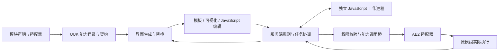

<!-- 作者：山海／dishanhai；按本次 20 轮需求访谈整理 -->
# Unified UI Kernel 主控：自动发现与全自动接口规格

## 文档状态
- 日期：2026-11-14（Asia/Taipei）。
- 状态：需求访谈完成；进入技术设计与可行性验证前的交接规格。产品代码尚未实现，未运行构建或游戏验收。
- 访谈轮次：20；需求歧义主观估计 8.5%，低于起草阈值 20%。评分只描述需求完整度，不代表实现正确性或安全性已得到证明。
- 首版：Minecraft 1.21.1 / NeoForge，客户端与服务端均安装 SH-Better-UI。
- 首版外部适配器：AE2。Forge 1.20.1、NeoForge 26.1.2 及其他模组适配放在后续迁移。
- 用户要求本轮通过问答敲定细节。脚本引擎选型已委托助手；未要求本轮开始修改产品代码、提交或部署。

## 目标
以 UUK 为主控，在现有模块、服务注册和页面系统上，提供自动发现与装配、业务定义驱动的界面生成，以及跨模组业务编排。接入方通过标准声明接入，或完全不改动代码而由 UUK 的通用协议与专用适配器接入。

“全自动”的范围由可声明、可验证的能力决定：自动发现和连接支持的能力、自动生成其界面、自动替换兼容界面，并在玩家启用规则后按条件执行。没有声明、协议或适配器的任意未知接口不做语义猜测。

## 已确认决策
| 项目 | 最终决策 | 访谈轮次 |
| --- | --- | --- |
| 自动化层级 | 自动装配 + 自动生成/绑定 + 未适配模组通过适配器接入 | 1、3 |
| 主控权限 | 可编排跨模组业务；原模组实际执行并校验 | 2 |
| 自动执行 | 界面自动接管；支持用户操作与预设规则后台触发 | 4 |
| 验收样板 | AE2 库存监控与自动补货；用户委托助手将流程模板具体化 | 5 |
| 编辑方式 | 模板配置 + 可视化编排 + JavaScript 扩展 | 6、16 |
| 生命周期 | 每条规则选择“仅界面打开时”或“玩家在线时”；不离线持续触发 | 7、8 |
| 暂停 | 停止后续触发，不取消已提交任务；恢复前核对任务状态 | 9 |
| 界面入口 | 统一控制中心 + 按模组/界面选择替换，保留原界面返回入口 | 10 |
| 启用权限 | 玩家自主启用自己的规则，受原模组权限约束 | 11 |
| 脚本访问 | 只调用 UUK 注册能力，不直接访问文件、网络或任意 Java 类 | 12 |
| 首版平台 | NeoForge 1.21.1；其他现有平台后续迁移 | 13 |
| 双端职责 | 客户端界面与编辑；服务端编排、权限与任务状态 | 14 |
| 失败重试 | 查询有限重试；写入先确认未执行或有去重保证；结果不明则暂停 | 15 |
| 重连/重启 | 保存且启用的规则核对权限、依赖及在途任务后，按原生命周期恢复 | 17 |
| 异常恢复 | 结果不明的异常规则不因重连/重启而自动重提任务 | 17 |
| 替换默认值 | 适配器支持且兼容性检查通过则默认替换；否则保留原界面 | 18 |
| 外部适配范围 | 首版只交付 AE2 完整样板和后续适配的标准接口 | 19 |
| 脚本进程 | UUK 管理独立执行进程，限制资源、超限终止、关服清理；不另装 Node.js | 20 |

## 核心交互与验收样板
1. 安装匹配版本的 SH-Better-UI 与 AE2；双端握手并核对能力。
2. UUK 发现 AE2 适配器及库存查询、合成请求、任务状态能力；只有适配成功的能力显示为可用。
3. 自动生成库存视图、补货设置与任务状态界面，进入统一控制中心；受支持原界面默认替换，并可切回。
4. 玩家选择“库存不足补货”模板，填写铁锭、下限 64、目标 256，选择界面模式或在线模式，主动启用规则。
5. 条件满足且该规则没有在途任务时，服务端核对实际库存、已有任务与权限，计算缺口并发起合成。模板数值是样板参数，不写死在核心中。
6. 显示计划/提交中、执行中、完成、失败、结果待核实等可区分状态；无配方、缺少材料或权限不足时显示具体原因。
7. 暂停规则后停止新的触发，已提交的 AE2 任务继续由 AE2 管理；恢复前核对旧任务，避免重复。
8. 重登或重启后按保存的启用状态恢复，但先核对权限、依赖和在途任务；界面模式等待对应页面重新打开。

AE2 的配方输出批量、网络可达性和材料变化均以真实接口结果为准；“目标 256”是库存目标，不能在未核实接口前承诺每种配方都精确产出 256。样板要求存在可用配方、材料、合成资源和玩家权限。

## 建议实现架构
以下是基于已确认需求的工程设计方向，尚未实现；新 API 名称在实现计划中确定。



### 发现、能力契约与兼容性
- 扩展现有固定描述文件与 loader 模组来源验证，复用模块 ID、版本、依赖排序和服务注册，不引入无边界 classpath 扫描。
- 能力描述包含稳定 ID、契约版本、提供者、执行侧、参数/结果结构、只读或写入属性、所需权限、可取消性及任务查询/去重支持。
- 按职责提供目录查询、数据读取、动作调用、规则管理和界面描述接口；适配器实现实际业务，核心不内置 AE2 特有业务规则。
- 自动连接前检查参数类型、版本、依赖、执行侧和权限；多个提供者存在歧义时不能靠类加载顺序任意选择。具体冲突优先级在实现 ADR 中固定并测试。
- 已加载不等于可用：目录应区分未安装、版本不支持、依赖缺失、无权限、可用及故障等原因。
- 模块卸载或重载时按生命周期撤销句柄；旧脚本或旧页面不能继续使用过期能力引用。

### 页面与规则模型
- 复用现有页面 schema、组件注册、主题、布局与 ScopeHandle；在声明中连接字段、命令、状态和反馈，不复制一套独立控件系统。
- 模板和可视化编辑共用版本化规则模型；JavaScript 通过脚本节点或独立脚本规则接入同一调度与权限体系。此为工程建议。
- 不承诺任意 JavaScript 与可视化图之间无损互转；脚本节点可保留文本并展示输入/输出契约。
- 控制中心呈现能力、规则、在途任务和失败原因；按模组与界面保存替换偏好。
- 规则配置与启用状态可持久化；具体存储格式、迁移版本和损坏恢复在实现阶段设计。
- 规则修改应有预览、保存与取消；涉及新资源消耗时明确操作对象、数量和启用后果。已有规则按获准条件自动执行，无需每次重新审批。

### 服务端权威与生命周期
- 客户端提交规则定义与操作意图；服务端以真实玩家身份校验，不能相信客户端或脚本自报的所有者、权限或网络归属。
- Minecraft/AE2 对象与实际动作留在所属服务端线程；工作进程只接收有界数据快照并输出能力请求。
- 界面模式绑定页面会话；关闭、断线或会话失效停止新触发。在线模式依赖服务端确认的玩家在线状态。
- 页面生命周期租约须由服务端管理并超时失效；界面状态不是提升业务权限的依据。
- 自动恢复只恢复正常启用的规则。因结果不明、权限撤销或不兼容暂停的规则，需要先解决原因，不能把重启当成再次提交的理由。
- 默认不强制加载区块。区块或目标不可用时等待/暂停并展示原因，不能隐式制造区块票据。此默认值沿用访谈中的运行前提。

### 任务结果、重试与去重
- 每个业务意图与尝试有稳定标识；已提交任务记录适配器提供的权威任务标识，不仅记录客户端请求编号。
- 提交前记录意图，提交后关联任务；在“原模组已执行但回执/本地记录未完成”的窗口内，状态必须允许标记为结果待核实。
- 没有原模组事务/去重支持时，不宣称跨进程崩溃场景可以保证 exactly-once；采用核对、暂停和人工处理避免盲目重复。
- 查询错误可以有上限的退避重试；具体次数与间隔在实现配置中确定。
- 写入只有在确认未执行或具有可靠去重契约时才重试；否则停止规则并保留核对入口。
- 只处理本规则/本次业务意图的任务，不取消其他玩家或其他系统创建的任务。
- 同一规则单个目标不重复发起在途任务；多个 UUK 规则命中同一库存目标时，需要计入已知待完成量并协调提交。外部行为并发的最终结果以原模组为准。

### JavaScript 引擎与独立进程
- **设计选择：Mozilla Rhino 上游引擎，运行于独立 Java 21 工作进程。** 精确发布版本、依赖校验和许可材料在实现预研中锁定；不是复用现有 KubeJS 执行上下文。
- 选择理由：纯 Java 运行时适合现有 Java 21 部署环境；独立进程承担可终止的故障边界。Mozilla 官方提供项目与发布信息，具体语言支持须按锁定版本验证。[Rhino 官方项目](https://github.com/mozilla/rhino)、[发布记录](https://github.com/mozilla/rhino/releases)。
- GraalJS 已作为候选查阅，但其隔离分发件和资源限制有版本/平台条件，本轮没有验证其目标组合，故不作为首版默认设计。[官方沙箱说明](https://www.graalvm.org/latest/security-guide/sandboxing/)。
- 不使用 Rhino shell 工具环境；创建受限上下文，默认拒绝 Java 类访问与原始 Java 对象泄漏，仅提供专用 UUK 函数与纯数据。
- 不开放 Node.js、浏览器对象、文件、网络、进程启动、任意 Java 类或类加载入口。模板/可视化同样不能绕过能力桥权限。
- 工作进程不加载 Minecraft 模组 classpath。通过受父进程管理的有界管道协议传递数据；不把业务对象、反射对象或任意宿主回调作为脚本值。
- 工作进程请求由父进程绑定的玩家/规则/会话上下文鉴权，不能靠请求中的自报身份提升权限。所有写请求在服务端重新校验。
- 父进程限制进程数量、脚本大小、消息大小、输出、排队量、执行时间和内存；指令计数作为辅助，硬截止由父进程监督和终止。具体阈值以目标机基准验证后固定。
- JVM 堆上限不等于总进程内存上限；需要核实 Windows/Linux 下的进程资源限制或监控策略。进程隔离本身也不等于操作系统权限沙箱。
- 使用当前受支持 Java 运行环境启动，无需用户另外安装 Node.js；运行时随发布交付的具体封装方案必须兼容现有 JAR 边界与许可证要求。
- Windows 后台隐藏启动。正常关服、单人退出、启动失败、超时及父进程意外消失时清理工作进程，防止孤儿进程。
- 脚本工作进程被杀后，已提交给 AE2 的任务仍继续；父进程将受影响规则置为故障/待核实状态，不自动重放写操作。

### 本地化与可访问性
- 所有用户可见文本使用项目语言键；中文 tooltip 使用简体中文，并维护现有语言资源。
- 沿用项目组件、图标和主题。保持键盘入口、可见焦点、旁白、返回路径与可恢复的筛选/滚动状态。
- 可视化编排验收按下、拖动、落点预览、释放、取消及边界；支持键盘完成核心操作。
- 长文本与 GUI 缩放时主要动作可达；高对比及减少动效下仍能辨认规则启用、等待、运行、暂停和失败状态。

## 当前代码证据与复用位置
| 文件 / 符号 | 已核对事实与用途 |
| --- | --- |
| src/main/java/com/dishanhai/sh_better_ui/kernel/internal/ClientUiKernel.java:143 | start 接收 loader 模组来源，151 行调用 NativeModuleSources.discover；481 行起有脚本页面作用域入口 |
| src/main/java/com/dishanhai/sh_better_ui/kernel/internal/NativeModuleSources.java:70 | 固定描述文件使用 modId 与实现类；要求 UIModule/公共无参构造器，校验模组来源 |
| src/kernel/java/com/dishanhai/sh_better_ui/kernel/internal/KernelHost.java:312 | ModuleDiscovery → DependencyGraph → register，可复用发现和依赖装配 |
| src/kernel/java/com/dishanhai/sh_better_ui/kernel/api/APIRegistry.java:11 | find(ServiceKey) / require(ServiceKey)，作为现有服务查询边界 |
| src/main/java/com/dishanhai/sh_better_ui/compat/kubejs/client/KubeJsPageBindings.java:66 | 现有页面 schema / ScopeHandle 绑定与关闭清理基础 |
| neoforge-1.21.1/src/main/java/com/dishanhai/sh_better_ui/compat/kubejs/ShBetterUiKubeJsPlugin.java:22 | 现有 SHUI 仅向 CLIENT 注册；34–38 行开放 Java 包，不是此次玩家脚本沙箱 |
| neoforge-1.21.1/build.gradle:11、80 | Java 21；Rhino 2101.2.7-build.81 是 compileOnly，不能据此认为运行时已交付 |
| neoforge-1.21.1/build.gradle / verifyLibraryJar | 当前禁止 dev/latvian 等第三方条目混入库 JAR；新增 worker 分发必须显式设计，不可通过放宽检查掩盖错误打包 |
| gradle/kernel.gradle | 共享 kernel / kernelTest 来源及测试任务；NeoForge 模块复用共享源码与资源 |

NeoForge 1.21.1 当前配置为 NeoForge 21.1.251、Kotlin 2.2.21、KotlinForForge 5.10.0；这些是本轮读取到的工作区快照，实施前再次核对。现有源码由多个任务修改中，后续不得覆盖无关改动。

## 实施阶段建议
| 阶段 | 交付与退出条件 |
| --- | --- |
| P0 可行性与契约 | 锁定 AE2 目标版本与公开接口；验证查询/提交/状态/权限及去重边界；锁定 Rhino worker 分发；通过隔离、预算和清理探针 |
| P1 发现与能力目录 | 在现有模块/服务体系上扩展能力描述、双端握手、兼容性与诊断；假适配器契约测试通过 |
| P2 规则与任务协调 | 实现生命周期、持久化、去重账本、失败分类、状态核对及恢复；覆盖崩溃窗口与多人归属 |
| P3 自动界面与控制中心 | 生成与绑定页面、替换策略、原界面回退、模板编辑及状态反馈；完成键盘/缩放等基础验收 |
| P4 可视化与 JavaScript | 两类编辑入口接入同一服务端契约；独立 worker、资源监督、协议校验和退出清理通过 |
| P5 AE2 贯通与交付 | NeoForge 1.21.1 单人及专用服务端通过完整样板；异常、重连、重启、权限及真实 UI 验收通过 |

这些阶段是交付顺序，不削减已确认的首版功能；只完成模板或核心编译不能宣布首版完成。

## 验收矩阵
| 编号 | 场景 | 必须观察到的结果 |
| --- | --- | --- |
| AC01 | 标准模块、重复/缺失/不兼容能力 | 可用能力正确注册；问题有明确诊断，不按偶然加载顺序装配 |
| AC02 | 安装 AE2，无改动接入方代码 | 适配器发现对应能力，生成可操作页面 |
| AC03 | 未安装 AE2 或版本不支持 | 核心可启动；说明不可用原因，不替换不兼容界面 |
| AC04 | 首次进入受支持界面与手动切回 | 默认替换；切回原版可用，偏好按模组/界面保存 |
| AC05 | 模板、可视化和 JS 表达同一规则 | 进入同一权限、生命周期、执行和任务反馈路径 |
| AC06 | 铁锭低于 64，有可用合成条件 | 按缺口向 256 目标提交；在途期间不重复提交 |
| AC07 | 关闭界面 / 玩家离线 | 对应模式停止新触发；已提交任务继续 |
| AC08 | 重登 / 重启 / 重新打开界面 | 核对权限、依赖和在途任务后按原条件恢复 |
| AC09 | 提交超时、回执丢失、记录窗口崩溃 | 查询/去重可确认则核对；无法确认则暂停，绝不盲目重提 |
| AC10 | 两名玩家与两条规则命中同目标 | 不冒用身份、不跨所有者取消任务；协调已知在途量，拒绝越权写入 |
| AC11 | 缺配方、材料不足、目标失效、权限撤销 | 有具体失败原因；写入不绕过原模组校验 |
| AC12 | 脚本尝试 Java/文件/网络及身份伪造 | 无对应访问能力；父进程拒绝非法能力请求 |
| AC13 | 无限循环、深递归、巨量分配、昂贵内建、超量输出 | 有界失败或终止 worker；游戏服务端继续响应，任务结果待核实而非重放 |
| AC14 | 脚本进程崩溃、父进程退出、单人离开、关服 | 状态可诊断；无持续遗留的 worker/JVM/辅助进程 |
| AC15 | 长文本、GUI 缩放、键盘、旁白、高对比、减少动效 | 主要信息和操作可取得；焦点、取消与返回符合项目规则 |
| AC16 | 成品分发与第三方消费 | 依赖边界清晰；消费方不打包本库；worker 许可与产物齐全，既有 KubeJS 行为不回归 |

实施时建议从目标模块运行：
```bash
cd neoforge-1.21.1
./gradlew test kernelTest build
```
当前构建入口已存在，以上是后续验证命令，本轮没有执行。产物位于 neoforge-1.21.1/build/libs/，具体名称与 worker 附属产物由后续打包设计固定。构建通过仍需单人、独立服务端、多人与实际整合包验收。测试实例及辅助进程必须在验证结束后清理。

## 实施前置项与交接限制
- AE2 精确版本、实际公开 API、支持替换的首批界面以及去重/状态查询语义尚未做接口级验证。
- Rhino 已作为设计选择，精确小版本、语言能力清单、独立进程分发、许可证材料和限制阈值待验证；不能仅依据引擎名称宣称安全。
- 进程总内存、跨平台退出清理、旧任务核对与多规则并发必须先形成探针和测试证据。
- 现有 kernel 复用路径已经初步核实，服务端新职责与协议的类级拆分仍需在实施计划中完成。
- 上述未完成工作已汇入根目录 TODO.md；.learnings 只记录本次已解决的工具使用经验。

## 假设辨析
| 原始歧义 | 已澄清结果 |
| --- | --- |
| 自动接管是否等于推断任意模组 | 否，通过标准协议/适配器，接入方零改动 |
| 自动发现是否立即获得业务执行权 | 界面可自动启用；业务规则由玩家手动启用，仍受原权限限制 |
| 后台是否意味着玩家离线持续运行 | 否，按规则选择界面模式或在线模式 |
| 暂停是否取消已经消耗资源的任务 | 否，只停止新触发 |
| 超时是否可以直接再次提交 | 否，先核对；不确定则暂停 |
| JavaScript 是否需要现有 KubeJS 模组环境 | 否，采用 UUK 管理的独立运行时，原 KubeJS 集成保持其职责 |
| 规则是否可以跨重启直接继续写入 | 先核对权限、依赖和在途任务；异常未知结果不自动重提 |

## 清晰度记录
| 维度 | 最终分数 | 权重 | 加权 |
| --- | --- | --- | --- |
| 目标 | 0.95 | 0.35 | 0.3325 |
| 约束 | 0.95 | 0.25 | 0.2375 |
| 验收 | 0.90 | 0.25 | 0.2250 |
| 既有实现上下文 | 0.80 | 0.15 | 0.1200 |
| 合计清晰度 | | | 0.9150 |

## 领域实体
| 实体 | 职责与关系 |
| --- | --- |
| UUK 主控 | 统一发现、装配、界面入口与运行时协调 |
| 标准接入模块 / 未适配模组 | 分别通过声明或适配器提供业务能力 |
| 业务定义 / 通用协议 / 适配器 | 描述与实现数据、动作、权限、版本和界面映射 |
| 跨模组业务流程 / 后台规则 | 组合能力，归属于规则所有者并服从规则运行模式 |
| 规则模板 / 可视化编排 / 脚本扩展 | 三类创作入口，共用执行契约 |
| 在途任务 | 原模组实际任务的关联记录，与规则暂停相区分 |
| 统一控制中心 / 界面替换策略 | 提供集中入口和可配置的原界面替换 |
| 客户端 / 服务端 | 客户端呈现；服务端权威编排与校验 |
| 脚本工作进程 / 能力调用桥 | 隔离脚本计算并通过纯数据契约请求授权操作 |
| 验收样板 | AE2 库存监控和自动补货，验证端到端路径 |

## 领域实体收敛
| 轮次 | 实体数 | 与上一轮稳定比例 |
| --- | --- | --- |
| 1 | 4 | — |
| 2 | 5 | 80% |
| 3 | 7 | 71% |
| 4 | 8 | 88% |
| 5 | 9 | 89% |
| 6 | 12 | 75% |
| 7 | 13 | 92% |
| 8 | 13 | 100% |
| 9 | 14 | 93% |
| 10 | 16 | 88% |
| 11 | 17 | 94% |
| 12 | 17 | 100% |
| 13 | 17 | 100% |
| 14 | 19 | 89% |
| 15 | 19 | 100% |
| 16 | 19 | 100% |
| 17 | 19 | 100% |
| 18 | 19 | 100% |
| 19 | 19 | 100% |
| 20 | 21 | 90% |

## 完整访谈记录

### 第 1 轮
问题：自动化接入边界：A 接入方提供标准声明/实现，UUK 自动发现装配；B 接入方仅提供业务定义，UUK 还自动生成界面及绑定；C 未适配 UUK 的模组也自动识别接管；D 自述。

回答：A+B+C

决策记录：目标同时包含标准模块自动装配、业务声明驱动的界面生成与绑定、未适配 UUK 的外部模组识别与接管。

### 第 2 轮
问题：对未适配模组，UUK 自动接管的权限上限：只发现与展示入口、接管界面与交互但保留原业务逻辑，还是也接管业务调用与执行流程？

回答：3

决策记录：权限上限包含跨模组业务流程编排、调用顺序和结果处理；原模组负责实际执行与服务端校验。

### 第 3 轮
问题：未适配模组接管的验收标准：接入方零改动但允许 UUK 维护适配器；只依赖通用协议而不写专用适配；还是完全未知接口也要求尝试推断？

回答：1

决策记录：采用接入方零改动方案：通过通用协议与 UUK 内置适配器识别能力；特殊模组由维护方补充适配器，安装后自动接管。未要求推断完全未知接口。

### 第 4 轮
问题：自动发现后的启用方式：自动接管界面但业务由用户触发；逐项确认才启用接管；还是同时允许预设规则在后台自动触发业务？

回答：1+3

决策记录：支持自动注册能力、数据连接与界面接管；业务既可由用户操作触发，也可按预设规则后台自动执行。后台规则来源、首次启用权限、运行侧与失败策略尚未确定。

### 第 5 轮
问题：首个端到端验收样板是什么：装入哪个模组，发现什么能力，生成什么界面，在什么条件下自动执行什么？请描述一条具体流程。

回答：按例子来

决策记录：用户委托按示例推进；此前仅给出流程模板，未指定具体模组。助手选择 AE2 库存监控与自动补货作为工作样板，可由用户纠正，不视为已实现能力。

### 第 6 轮
问题：首版后台规则的编辑能力：预置模板加参数配置；可视化自由组合条件与动作；或额外支持脚本编程？

回答：1+3

决策记录：规则编辑同时提供预置模板配置、可视化自由编排与脚本扩展。助手提出三层入口共用规则模型的设计方向，具体脚本语言、运行环境与执行边界待确认。

### 第 7 轮
问题：后台规则的运行生命周期：仅界面打开期间运行；关闭界面仍运行但玩家离线暂停；或服务端托管且玩家离线仍运行（限服务器和目标区块正常运行，不默认强制加载区块）？

回答：1/2

决策记录：用户选择了界面打开期间与玩家在线期间两个候选生命周期；暂按同时支持两种模式理解，具体选择粒度尚需确认。没有获得离线持续托管的授权。

### 第 8 轮
问题：1/2 两种运行模式如何选择：逐条规则设置；全局统一选择；还是按创建入口自动区分为临时界面规则与持久在线规则？

回答：1

决策记录：确认同时支持两种运行模式，由每条规则单独选择：仅界面打开时运行，或玩家在线时持续运行。生命周期的暂停、恢复及在途任务处置仍待确定。

### 第 9 轮
问题：规则因关闭界面、玩家离线或手动暂停而停止时，对本规则已提交给原模组的在途任务：只停止新触发并允许已提交任务继续；还是同时请求取消其中支持取消的任务（已完成操作不回滚）？

回答：1

决策记录：规则暂停仅阻止后续触发和新任务提交，已提交给原模组的任务继续执行；恢复时重新查询实际任务状态，避免重复提交。不因此默认取消在途任务。

### 第 10 轮
问题：对于已有界面的模组，自动生成的 UUK 界面如何呈现：统一控制中心增加新入口并保留原界面；直接替换受支持的原界面并可退回；或两者都支持并按模组/界面配置？

回答：3

决策记录：同时提供 UUK 统一控制中心和原界面替换；允许按模组或具体界面配置是否替换，并保留退回原界面的入口。替换默认值尚未决定。

### 第 11 轮
问题：会修改物品、发起合成或消耗资源的后台规则由谁启用：玩家在原模组已有权限内自主启用；服主允许自动化能力后玩家自主启用；或每条规则均需服主批准？所有选项均保留原模组服务端校验。

回答：1

决策记录：玩家可手动自主启用自己的后台规则，无需逐条服主审批；执行范围受原模组已有权限和服务端校验约束。此选择未决定脚本宿主访问权限。

### 第 12 轮
问题：脚本访问边界：仅调用 UUK 注册能力并进行条件/流程编排；还是还需访问文件、网络和 Java 类等宿主能力（具体范围需另行定义）？

回答：1

决策记录：脚本仅能调用 UUK 已注册能力接口并进行条件与流程编排；新增业务能力通过适配器扩展。不开放脚本直接访问文件、网络或任意 Java 类。脚本语言、运行侧和资源限额仍待定义。

### 第 13 轮
问题：首版目标平台：Forge 1.20.1、NeoForge 1.21.1、NeoForge 26.1.2 同步覆盖，还是优先其中一条？

回答：3 1.21.1

决策记录：首版优先 NeoForge / Minecraft 1.21.1；Forge 1.20.1 与 NeoForge 26.1.2 属于后续迁移范围，不作为首版同步交付要求。

### 第 14 轮
问题：首版部署边界：允许要求客户端与服务端均安装 UUK，并由服务端执行受权限约束的业务编排；还是要求客户端单独安装也提供核心使用体验，服务端缺失时按实际能力降级？

回答：1

决策记录：首版允许要求客户端与服务端均安装 SH-Better-UI/UUK。客户端负责界面和规则编辑，服务端负责业务编排、权限校验和任务状态。单人游戏使用内置服务端；规则继续遵守逐条设置的界面打开期间或玩家在线期间生命周期。

### 第 15 轮
问题：业务调用失败的默认策略：分类处理，查询有限重试，写操作只在确认未执行或具备去重保证时重试，结果不明则暂停并提示；或任何失败立即暂停并由用户恢复？

回答：1

决策记录：默认按失败类型处理：查询允许有限重试；写操作只有确认未执行或接口提供去重保证时才重试。结果不明时暂停规则并展示原因，恢复前核对实际任务状态。

### 第 16 轮
问题：规则脚本的语言偏好：JavaScript、Lua，或无偏好由技术评估决定？语言选择不改变仅调用 UUK 能力接口的限制。

回答：1+3

决策记录：采用 JavaScript 作为规则脚本语言；具体引擎由助手根据运行限制、依赖体积和维护成本评估选择。仍只开放 UUK 能力接口，不开放浏览器、Node.js 或任意 Java 类。此回答不视为授权进入产品代码实现。

### 第 17 轮
问题：保存的已启用规则在重新登录或服务器重启后：自动核对权限/依赖/在途任务并在生命周期满足后恢复；还是统一保持暂停、由用户手动恢复？

回答：1

决策记录：保存且已启用的规则在重新登录或服务器重启后，先核对权限、依赖和在途任务，再在原有生命周期条件满足时自动恢复。界面模式仍须打开对应界面，在线模式须玩家在线。因执行结果不明而暂停的异常规则，不因重登或重启自动重提任务。

### 第 18 轮
问题：支持替换的原界面默认行为：适配器确认支持后自动启用替换，并可按模组/界面退回；或默认保留原界面，玩家逐项开启替换？

回答：1

决策记录：适配器确认支持且兼容性检查通过的原界面默认自动启用 UUK 替换；玩家可按模组或具体界面切回原版。未适配或兼容性检查未通过的界面保留原版。

### 第 19 轮
问题：首版外部模组适配范围：先交付 AE2 完整样板并保留标准扩展接口；还是还必须同步支持其他指定模组（请给名称）？

回答：1

决策记录：首版外部适配器只要求 AE2，完成库存查询、自动补货、任务状态及受支持界面接管的完整样板，并交付可供后续适配器使用的标准接口。核心仍包含自动发现、界面生成、模板、可视化编排和 JavaScript 扩展。

### 第 20 轮
问题：为隔离玩家 JavaScript 的失控和内存消耗，是否允许 UUK 在服务端自动管理独立脚本执行进程（无需另装 Node.js、后台隐藏启动、超限终止、服务端关闭时清理），还是必须只在游戏 JVM 内运行？

回答：1

决策记录：允许 UUK 在服务端自动管理独立 JavaScript 执行进程：后台启动、限制内存与执行时间、失控时终止、关服时清理；无需用户另装 Node.js。脚本只通过 UUK 能力桥请求操作，游戏 JVM 保持业务与权限权威。
