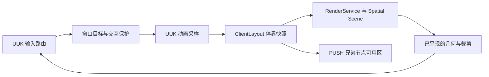

<!-- 作者：山海／dishanhai -->
# 自适应停靠与折叠窗口

Forge 1.20.1 和 NeoForge 1.21.1 共用窗口、停靠、动画和提示条实现。服务通过 `UnifiedUI.get().find(UIApis.WINDOWS)` 或已运行模块的 `context.engine().require(UIApis.WINDOWS)` 解析。相同 ID 的能力用于模块依赖声明。消费模组独立声明 SH-Better-UI 依赖。

## 最小接入

在模块拥有的活动 Screen 上，通过 `UIApis.SCREENS` 挂载一个树作用域，然后创建窗口。也可以传入 `ScreenService.session` 返回的作用域，在无 Screen 时被动显示在 HUD 上。

```java
var engine = context.engine();
var scope = engine.require(UIApis.SCREENS).mount(context, screen, UiId.parse("mymod:monitor_screen"));
var monitor = engine.require(UIApis.WINDOWS).createMiniWindow(context, scope,
        MiniWindowSpec.builder("mymod:monitor")
                .title(Component.translatable("mymod.monitor"))
                .compactIndicator(() -> new ProgressIndicator(20, 4, viewModel::progress, 0xff80caff, 0xff304355))
                .content(() -> (draw, view) -> draw.text(
                        Component.translatable("mymod.monitor.status", viewModel.percent()),
                        (int) view.bounds().x() + 8, (int) view.bounds().y() + 8, view.foregroundArgb()))
                .persistent(true)
                .build());
```

默认左侧停靠，28×80 GUI px 提示条和 260×180 GUI px 展开面板。悬停打开延迟 120 ms，移开关闭延迟 350 ms。两个工厂各持有独立视图，可以读取同一 ViewModel。展开内容第一次露出时创建，折叠后保留实例。更新 ViewModel 后，提示条按其采样频率读取数据。

## 服务契约与生命周期

| 服务 | 调用 |
| --- | --- |
| `UIApis.COLLAPSE` | `create(context, scope, spec)` 创建通用折叠句柄。模块声明 `CollapseService.PROGRESS_CLAIM`。通过监听器接收四态变化，通过句柄查询当前进度和目标。 |
| `UIApis.WINDOWS` | `createMiniWindow(context, scope, spec)` 创建和管理窗口。查询带模块上下文。窗口 ID 必须属于模块命名空间，并且在同时存活的窗口中唯一。 |
| `UIApis.DOCK` | `dock(handle, request)` 应用位置与模式，`layout()` 返回最后呈现的布局，`inspectCollisions()` 返回交叠与溢出，`diagnostics()` 返回 CPU 阶段耗时和窗口数量。 |
| `UIApis.LAYOUT` | `dockContentArea(context, node)` 返回当前已求解的 PUSH 可用区域。受管兄弟节点可在视觉布局的帧采样回调中使用它。 |

创建、操作、关闭和读取句柄都在客户端线程进行。保存布局使用脱离 UI 对象的值快照，在后台串行执行原子替换。窗口挂载受消费模块、宿主 Screen 或 HUD 会话约束。关闭其中任一作用域会释放内容、折叠轨道、空间节点与指针租约。资源重载会关闭已有窗口。仍活动的 Screen 可在重载完成后用原挂载作用域重新创建窗口。内容通过 `WindowContent.close()` 释放自己持有的订阅。持久化记录按窗口 ID 恢复，`resetPlacement()` 删除该记录并恢复规格默认值。

通用折叠支持水平、垂直和受控进度。调用者可把进度映射到所在布局的轴向尺寸。默认展开 240 ms、收起 200 ms，曲线支持 ease、linear 和 spring。途中反向使用现有轨道的瞬时位置和速度进入弹簧收敛。受控句柄由调用方提交 `[0,1]` 进度。MiniWindow 由窗口服务持有进度，规格只接收非受控动画。

## 输入、布局与材质



- 指针离开提示条和展开面板后进入收起延迟。面板边缘的短走廊允许穿越。固定、键盘焦点与活动手势保护展开。显式展开或收起保持到下一次悬停状态变化。关闭句柄立即释放窗口。
- `WindowContent.input` 接收窗口范围内的按下和滚轮，返回 `FOCUS` 取得按键和字符，返回 `CAPTURE` 继续接收后续拖动和放开。所有事件坐标使用 GUI px。焦点内容先处理 Esc，随后窗口处理，未处理的输入继续交给原生 Screen。支持作用域、模态和失焦清理。
- 拖标题栏时窗口跟随指针，吸附候选边会高亮，释放后提交停靠或浮动。右下角调整尺寸，Esc 取消当前手势，窗口焦点内 Ctrl+Z 可恢复上一次位置。位置优先级用于同边排序，交叠时焦点窗口在前。
- `OVERLAY` 是默认模式。`PUSH` 发布内边距供受管布局消费。四边都留出安全区，HUD 额外预留底部空间。同边先分配提示条容量，再分配展开余量。空间不足的条目进入 overflow 并在有空间时重新出现。跨边与浮动交叠可从碰撞结果查询。
- 颜色来自 Kernel 主题，阴影由同一几何更新 Spatial Scene。可选 `glass(GlassMaterial)` 通过原有共享 backdrop 渲染。禁用模糊或使用高对比时走主题底板。减少动效由现有动画偏好驱动。内容从窗口快照读取裁剪范围。
- `LayeredIndicator` 按层级叠加图标、文字、状态、通知数、进度和频谱，单层错误会禁用该层。频谱接收调用者已采样的振幅数组。调用者提供实时游戏或音频数据的快照。原生渲染上下文由框架管理裁剪和状态恢复。

## 示例与验收

进入游戏后执行 `/shbetterdock`。把鼠标停在左侧提示条，展开后拖动强度条、滚轮浏览样本、点击确认通知或输入备注。F8 切换面板，F7 循环四边，F6 重置位置，F9 查看状态、目标、悬停、焦点、指针捕获、层级、布局版本和计时。F10 添加同边通知窗口，并让示例页标题和帮助文字使用 PUSH 后的可用区。模拟频谱由示例每 tick 生成。Ctrl+Z 在窗口焦点内恢复上次位置。离开页面后重开，可检查位置恢复。

| 阶段 | 文件与入口 |
| --- | --- |
| A 勘察 | [内核架构](kernel-architecture.md) 与 [视觉快照](VISUAL_ALIGNMENT.md)。实际标识采用 `UiId`，客户端服务延用带 `ModuleContext` 的作用域授权。 |
| B 核心 | `kernel/api/dock`、`ClientCollapse`、`DockHover`、`ClientDockWindows`。折叠、悬停与输入走共用帧。 |
| C 停靠 | `DockLayout`、`DockPersistence`、`ClientDockStore`。布局与配置协议可用纯 Java 测试。存档 v1 自动补齐空组，损坏单行跳过，未知版本保留原文件。 |
| D 视觉 | `ClientLayout`、`ClientRender`、`ClientDockWindows`，共用主题、玻璃捕获、空间阴影与裁剪。 |
| E SDK | `DockExampleScreen`、三套语言资源和 `DockSmoke`。进阶 Studio 工作和额外验收记录在 [TODO](../TODO.md)。 |

### 构建与原生烟测

```bash
./gradle-install/gradle-8.8/bin/gradle --offline kernelTest test build
./neoforge/gradlew -p neoforge --offline kernelTest test build
./gradle-install/gradle-8.8/bin/gradle --offline -I gradle/kernel-smoke.init.gradle -PkernelSmokeDock runClient
./neoforge/gradlew -p neoforge --offline -I ../gradle/kernel-smoke.init.gradle -PkernelSmokeDock runClient
```

原生烟测在 `build/kernel-verification/client-<loader>-dock/` 输出截图和成功、停止标记。测试包含窗口尺寸与版本、真实按键和字符路径、指针捕获、右侧停靠、浮动、GUI Scale、资源重载与清理。

| 平台 | 构建与测试 | 原生烟测 |
| --- | --- | --- |
| Forge 1.20.1 / 47.4.16，客户端 Java 17 | `kernelTest` 259 项、`test` 931 项，发行包校验通过 | `runClient` 通过 |
| NeoForge 1.21.1 / 21.1.251，客户端 Java 21 | `kernelTest` 259 项、`test` 933 项，发行包校验通过 | `runClient` 通过 |

每端包含 29 项 ADCWS 自动测试。原生客户端另外检查禁用模糊和高对比时的前景像素、资源重载前后的放置恢复、外部点击传给原生控件、系统监控示例与同边 PUSH、世界登录和 HUD 绘制、打开 Screen 暂停 HUD、返回游戏恢复 HUD、退出世界释放会话以及关闭客户端释放玻璃捕获资源。

### 布局微基准

本机 Java 17，1280×720 GUI 视口，8 px 边距，四边分布，4 px 窗口间隔，逐帧改变动画进度，预热 5,000 次后采样 10,000 次。计时覆盖纯 Java 布局与碰撞求解。

| 窗口数 | 平均 ms | P95 ms | 最慢 ms |
| ---: | ---: | ---: | ---: |
| 1 | 0.005 | 0.004 | 4.352 |
| 10 | 0.013 | 0.031 | 1.898 |
| 50 | 0.111 | 0.253 | 20.211 |

### 原生客户端采样

在同一台 Windows 11／RTX 4060 Laptop GPU 机器上，800×480、GUI Scale 1。每组预热 24 帧并采集 60 帧，窗口网格使用带空间阴影的普通主题底板。每帧移动其中一个窗口 1 GUI px，确保触发布局求解。表格使用平均／P95／最慢值，单位为 ms。原始数据在每端烟测目录的 `dock-native-profile.tsv`。

| 平台 | 窗口 | 帧间隔 | 布局求解 | CPU 绘制提交 |
| --- | ---: | ---: | ---: | ---: |
| Forge | 0 | 16.834 / 17.968 / 19.317 |  |  |
| Forge | 1 | 16.727 / 17.053 / 17.846 | 0.048 / 0.057 / 0.065 | 0.200 / 0.253 / 0.321 |
| Forge | 10 | 16.735 / 17.106 / 17.388 | 0.051 / 0.080 / 0.166 | 0.624 / 0.747 / 0.832 |
| Forge | 50 | 16.784 / 17.333 / 17.784 | 0.071 / 0.095 / 0.214 | 2.645 / 2.884 / 3.063 |
| NeoForge | 0 | 16.833 / 17.904 / 18.023 |  |  |
| NeoForge | 1 | 16.715 / 17.220 / 17.741 | 0.055 / 0.078 / 0.152 | 0.205 / 0.272 / 0.360 |
| NeoForge | 10 | 16.762 / 17.674 / 17.841 | 0.053 / 0.081 / 0.168 | 0.604 / 0.799 / 1.000 |
| NeoForge | 50 | 16.804 / 17.557 / 17.652 | 0.074 / 0.108 / 0.162 | 2.511 / 2.723 / 2.844 |

`DockService.diagnostics()` 提供最近一次布局求解、CPU 提交和输入路由时间。玻璃捕获及降级计数见 `GlassService.diagnostics()`。高密度液态玻璃场景、GPU 时间、分配量和端到端输入延迟仍需单独采样。
