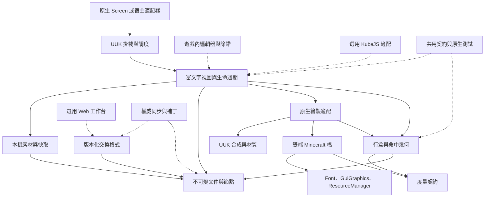

<!-- 作者：山海／dishanhai -->
# 富文字與行內內容架構

富文字是 Unified UI Kernel（UUK）所管理的內容子樹。宿主決定掛載位置、可用寬度和可見範圍，UUK 負責該子樹的量測、排版、呈現及已啟用的輸入。Forge 1.20.1 與 NeoForge 1.21.1 共用文件與排版契約。各自的 `UiClient` 保留原生事件入口。

## Phase 0 審計範圍

2026-11-11 核對 `AGENTS.md`、下列四份現行文件、雙端 Gradle 與對應源碼。來源樹及 `docs/` 內沒有額外適用的 `AGENTS.md`。`git status --short` 顯示開工前已有視覺組合、材質、文件和兩端事件橋接的修改與未追蹤檔案。下表以目前工作樹為準，其中 `client/visual` 與若干視覺組合接線屬於開工前的工作樹差異。既有工作保留，後續各階段以同一基線區分原有失敗和新增回歸。 [API_REFERENCE](API_REFERENCE.md) · [VISUAL_ALIGNMENT](VISUAL_ALIGNMENT.md) · [effects](effects.md) · [kernel-architecture](kernel-architecture.md)

| 領域 | 現有入口與能力 | 富文字整合點與缺口 |
| --- | --- | --- |
| 中央註冊 | `UnifiedUI.get().require/find(ServiceKey)`、`UIApis`、`BuiltinService`、`ModuleContext`、`ScopeHandle`。服務在登記階段加入、型別和契約版本經註冊表校驗，生命週期由模組和掛載範圍管理。 | Phase 1 由 `RichTextView.attach` 掛接既有受管節點，透過 `UIApis.RESOURCES` 觀察資源世代。`UIApis.RICH_TEXT` 留在日後有獨立服務需求時評估。 |
| 量測與失效 | `LayoutService.bind(module, node, writer, measure, arrange)` 在 `ClientLayout` 取得範圍內的 `LAYOUT_MUTATION` 寫入租約，合併 `MEASURE/LAYOUT`。`styles` 接收主題的量測、佈局及繪製失效。 | Phase 1 在既有 `bindVisual` sampler 呼叫 `RichTextView.prepare`。純 Java `RichTextLayout` 計算行盒、換行和命中快照，宿主使用結果安排對齊節點。 |
| 視覺對齊 | `LayoutApi`／`AlignmentLayout` 提供局部矩形、姿態、基線約束、光學邊界、像素吸附、裁剪和增量解算。`LayoutService.bindVisual` 透過 `ClientLayout` 及 `VisualFrameCoordinator` 將 `FrameViewSnapshot` 綁定於活動 Screen。每個 Screen 掛載只容許一個作用中的視覺綁定。 | 整塊富文字可作為宿主的一個已對齊節點，段落內的斷行在富文字量測中求解。視覺綁定由 Screen 宿主共用。 |
| 文字與圖形 | `UiText`、`UiFormattedText`、`UiTextEffects`、`GraphicIcon` 和 `GraphicDisplayLayout` 提供文字對齊、原生 `Component`／`FormattedCharSequence`、FCS 色彩位移和圖文列表。`AlignmentAssets` 提供字形視覺度量及貼圖透明邊界快取。 | 富文字需要自己的內容模型和連續行盒。FCS／原生文字 Mixin 維持現行相容入口。`GraphicIcon` 的方形圖示契約與任意寬高行內圖片不同。 |
| Screen 與輸入 | `ScreenService.create/mount`、`UiScreenBuilder.onRender/onForeground`、`InputService.target`、`FocusService`、`CollisionService`、`UiPointerCapture`、`UIEventBus` 以及 `AccessibilityService`。原生橋先處理模態、疊層和已捕獲指標，再交 UUK 路由。 | Phase 1 提供快照的可見幾何。互動節點接 `InputService`、既有捕獲與原生焦點，使用同一呈現快照。可存取性、指標手勢和選擇按階段加入。 |
| 主題與動效 | `ThemeService` 共用 `ThemeManager`／`ThemeScope`，`AnimationService` 提供作用域軌道，`UiFrameScheduler` 使用原生幀時鐘，`UiPreferences` 攜帶減少動效及高對比偏好。 | 字型或度量變更標記重排。只影響顏色與合成的變更沿用同一行盒。富文字採用現有主題分支與動畫時鐘。 |
| 即時效果與玻璃 | `BlurApi` 對 Java 包裝 `GlassBlur` 和 `GaussBlur`。共用 Kotlin `GlassBlur.kt` 提供即時區域取樣、圓角與頁面、彈窗請求。`UIApis.GLASS`／`GlassService` 與 `RenderService.Context.glass` 提供受管 Liquid Glass。`VisualReveal` 提供已繪區域、原圖回退及徑向漸變，兩端各有 `VisualRevealRenderer`。 | Phase 4 使用宿主 pass 的同一幾何、姿態與裁剪，並沿用同一主場景、已有暫存目標和回退。 |
| 幀末渲染 | 兩端 `UiClient` 將 Pre、Post 和輸入委託共用 `NativeClientBridge`。兩端各自的 `GaussBlur` 處理主／附加請求、即時取樣及頂層回呼。`RenderService.submit` 提供受管 SCREEN／HUD、內容、疊層及 Tooltip。 | 現有 compositor 支援受管 Screen 合成與固定階段，調度器及資源租約已檢查 `REGISTER_RENDER_PASS`。任意節點的讀寫依賴 DAG、GPU 合批、資源衝突驗證與外部 Pass SPI 仍待交付。 |
| 資源、網路及腳本 | `ResourcesService.version/observe/alignmentAssets` 由 `ClientResources` 在 Loader 資源套用成功後通知。現有 Live Activity 有自身平台封包，KubeJS 使用獨立選用橋接。 | Phase 1 的靜態 PNG 檢查有明確的檔案、邊長和像素限額。資源世代更新時丟棄檢查結果與呈現。Minecraft 的紋理管理器負責已上傳紋理。遠端、動畫解碼、動態紋理、富文字同步協議及 KubeJS 節點擴充各有後續門禁。 |

源碼入口 [UIApis](../src/main/java/com/dishanhai/sh_better_ui/kernel/api/UIApis.java) · [LayoutService](../src/main/java/com/dishanhai/sh_better_ui/kernel/api/LayoutService.java) · [ClientLayout](../src/main/java/com/dishanhai/sh_better_ui/kernel/internal/ClientLayout.java) · [AlignmentLayout](../src/main/java/com/dishanhai/sh_better_ui/client/gui/layout/AlignmentLayout.java) · [BlurApi](../src/main/java/com/dishanhai/sh_better_ui/client/api/BlurApi.java) · [GlassBlur](../src/main/kotlin/com/dishanhai/sh_better_ui/client/glass/GlassBlur.kt) · [VisualReveal](../src/main/java/com/dishanhai/sh_better_ui/client/gui/scaled/VisualReveal.java) · [共用原生橋](../src/main/java/com/dishanhai/sh_better_ui/client/NativeClientBridge.java)

平台事件及模糊實作 [Forge UiClient](../src/main/java/com/dishanhai/sh_better_ui/client/UiClient.java) · [Forge GaussBlur](../src/main/java/com/dishanhai/sh_better_ui/client/blur/GaussBlur.java) · [NeoForge UiClient](../neoforge/src/main/java/com/dishanhai/sh_better_ui/client/UiClient.java) · [NeoForge GaussBlur](../neoforge/src/main/java/com/dishanhai/sh_better_ui/client/blur/GaussBlur.java)

## 邏輯模組與依賴

實線表示目前實作依賴，虛線表示待交付的方向。箭頭由呼叫方指向依賴。使用兩個既有 Gradle 工程和共用源集，邏輯模組透過套件隔離。



- 文件資料與行盒運算可以在 Java 17 下獨立測試。純 Java 的 `src/kernel/java` 只容納無 Minecraft、Loader、GL 相依的型別。`ResourceLocation` 轉接、實際字型和資源回呼放在 Minecraft 端源集，供兩端共用。平台專屬簽章差異留在適配器。
- 已掛載的 Screen 樹屬呼叫模組。`RichTextView.attach` 接受擁有者的 `ModuleContext`、`ScopeHandle` 與 `AlignmentLayout.Node`。資源訂閱由 UUK 核對所有權，視圖繪製時核對該範圍與 pass 的 ID 和世代。宿主可在一個 `bindVisual` pass 內繪製多個節點。重開建立新世代，GUI Scale 或尺寸改變保留活動掛載並重新量測。訂閱和快取隨範圍釋放。
- 原版 Screen 或第三方庫保有原生控件、焦點、Esc、旁白與外圍事件。宿主在掛載範圍內提供回呼及座標。需要事件攔截時由 UUK 核對有效命中與權限。HUD、Tooltip 和其他框架各自以其宿主階段接入。
- 專用伺服器只載入純資料、驗證及協議層。網路、標記、Web 和編輯器透過受控模型交換資料。Java SPI 可依權限操作框架，受信任 JVM 程式碼本身有完整執行能力。非信任資料採白名單節點、動作 ID、驗證參數、大小與遞迴深度限制。
- 內建編輯器在客戶端 Screen 內持有草稿、選取和有界撤銷記錄。屬性先驗證為新的不可變文件，再交給原生 `RichTextView`。疊層與指標命中消費同一呈現快照。播放頭只控制媒體取樣，原生幀、佈局和資源世代仍由 UUK 管理。
- 檔案頁明確執行本機讀寫。Java 和 JSON 匯出共用被動 v1 Codec，擴充以惰性資料保留。Web 工作台在瀏覽器處理本機檔案及文字，消費方可將輸出透過自身作用域載入原生預覽。 [編輯和交換](RICH_TEXT_RELEASE.md) · [消費方範例](RICH_TEXT_SDK.md)

## 執行緒、快照與合成

純排版可接受已複製的不可變輸入和純度量替身。`Font`、翻譯、貼圖管理器和 `GuiGraphics` 操作遵守 Minecraft 客戶端及渲染回呼的執行緒要求。背景執行緒只解碼或計算純資料，完成後透過 `UIScheduler` 或 Loader reload barrier 回到所有者執行緒。核對 scope 世代與資源版本後才能套用。GPU 上傳、釋放與原生回呼均留在合法渲染階段。背景失敗交付可識別的狀態，關閉或過期結果在交付點丟棄。

1. 原生幀首同步 viewport、交付狀態變更並依 UUK 相位執行樣式、`MEASURE`、`LAYOUT`、`ANIMATION`、`GEOMETRY_UPDATE` 和 `RENDER_PREPARATION`。現有 `UIPhase` 把 `ANIMATION` 放在一般量測與佈局之後。Phase 1 使用靜態行內幾何。日後尺寸動畫在對應宿主的既有視覺綁定內取樣一次，再求解該幀幾何。前序核心相位維持原契約。
2. `ScreenEvent.Render.Pre` 開啟視覺組合階段。宿主畫完背景後進入 `bindVisual`，其 sampler 使用 `FrameTime`。`RichTextView.prepare` 依文件、字型、寬度與資源世代取得行盒。`AlignmentLayout.resolve` 發布 `FrameViewSnapshot`，再由 `RichTextView.draw` 使用同一 pass 的宿主姿態與裁剪。成功繪製後發布富文字呈現。
3. 即時 backdrop 或 Reveal 在既有場景畫好後取樣，接著依文件順序畫內容。`GaussBlur` 在 Screen Post 消費主請求和附加效果，執行舊 `deferTopLayer`，再由 `VisualFrameCoordinator` 依 Z 和登記順序執行受管前景。最後畫原有疊層並進入 Kernel `RENDER`。現行受管主模糊每 Screen 幀一槽且舊主請求優先。旋轉、傾斜、翻轉的矩形 framebuffer 模糊和 Screen 階段外的受管請求有明確拒絕結果。普通 HUD 走現有 HUD／即時路徑。
4. 指標事件用最後成功畫出的富文字快照。首次呈現、範圍關閉、世代不符或舊資源已失效時，對應命中不可用。輸入引發的狀態改變交由下一個呈現週期採用。在原版與受管佈局共存時，同一控件由既有焦點和輸入入口消費一次。

排版使用局部邏輯 GUI 座標。宿主以對齊節點的局部 clip 設定內容視口。父容器姿態、捲動與裁剪得到屏幕 GUI 幾何，再由既有適配器按當前 GUI Scale 和實際 framebuffer 範圍投影。Phase 1 命中回傳行內盒，圖片等比例留白仍屬該盒。即時及幀末效果重用同一投影。GPU 合批只能跨連續且具相同材質、深度、裁剪和混合契約的命令。Phase 4 的 Pass 貢獻需驗證依賴環、資源讀寫與階段，禁止取樣正在寫入的附件，異常後恢復 pose、scissor、shader、紋理、混合、深度、viewport 及 render target。 [現有合成階段](API_REFERENCE.md#visual-layout--render-composition) · [排程](scheduler.md) · [權限](permissions.md)

## 公開契約草案與相容性

下表描述角色和預定契約。精確的已實作名稱、參數與可呼叫入口以 Phase 1 API 文件及雙端源碼為準。

| 角色 | 資料、所有權與失敗語義 | 最早交付 |
| --- | --- | --- |
| `RichDocument`、`InlineNode`、`TextRun`、`ImageNode` | 不可變文件保留節點順序。節點與貼圖以 `UiId` 表示。文件拒絕重複節點 ID，節點拒絕 null 與非正圖片尺寸。讀取純資料可跨執行緒。持久化及 patch 身分另有版本契約。 | Phase 1 基本節點，Phase 2 持久身分及 Codec |
| 行盒與 `RichLayoutSnapshot` | 一次排版發布同一版次的行盒、繪製位置和命中矩形。Phase 1 圖片依固有比例縮至文字行度量，換行保留節點比例。超寬與缺圖用確定性幾何處理。空內容、裁剪外和無呈現時以空結果表示。 | Phase 1 矩形，Phase 2 字形群集與選擇映射 |
| `RichTextView` | 呼叫者提供擁有的掛載、對齊節點和文件。在客戶端渲染執行緒掛載、準備、繪製、查詢與釋放，生命週期跟隨 scope。`draw` 使用宿主 `VisualLayoutBinding.LayoutPass`，失效狀態無命中。 | Phase 1 基本掛載 |
| 靜態 PNG 與擴充 SPI | `RichTextView.image` 接受原生 `ResourceLocation` 和宣告尺寸。宣告比例決定行內盒，實際 PNG 按自身比例在盒內繪製。缺失或損壞素材保留盒並畫占位。成功重載後重建快照。進階擴充使用命名空間、能力版本及受管 lease。 | Phase 1 原生文字與 PNG，Phase 3–5 擴充 |
| 編輯器及同步 | 原子編輯與可撤銷的交易保留選擇，IME 在平台端保留組合文字。補丁需帶基線版次、順序及權威驗證。重複、過期、未知版本及越權有可辨識的拒絕與重新同步。 | Phase 2 編輯基礎，Phase 6 同步，Phase 7 編輯器 |

| 項目 | Forge 1.20.1 | NeoForge 1.21.1 |
| --- | --- | --- |
| Loader 與 main | Forge 47.4.16，Java 17 | NeoForge 21.1.251，Java 21 |
| Java 合約與測試 | 共用 `kernel`、`kernelTest` 使用 `--release 17`。main 測試使用 Java 21。 | 同一組 `kernel` 和測試，main 測試使用 Java 21。 |
| 原生事件、資源與紋理 | `ForgePlatformBridge`、Forge `UiClient`，滾輪以 `(0, dy)` 轉譯。 | `NeoForgePlatformBridge`、NeoForge `UiClient`，滾輪保留 `(dx, dy)`。 |
| 相依與產物 | Kotlin 2.2.21，KotlinForForge 4.12.0，Forge 重映射發行 JAR。 | Kotlin 2.2.21，KotlinForForge 5.10.0，NeoForge 發行 JAR。 |
| 富文字呈現契約 | UUK Screen 共用 API，原生畫面及命中由各自開發客戶端驗證。 | 同一 API 和結果語義，使用對應平台的 `Font`、`GuiGraphics` 及資源適配。 |

兩端沿用既有 `mod_id` 與公共命名空間。JEI、LDLib 與 KubeJS 維持選用。共用 Java 使用 Forge 1.20.1 所允許的語言和可用 API 子集。原版／第三方／HUD／Tooltip 的富文字相容性依適配器的實測結果發布。舊 `UiText`、`UiFormattedText`、`GraphicIcon`、`LayoutApi`、`BlurApi` 和既有 KubeJS 方法保留原簽章。 [Forge 構建](../build.gradle) · [NeoForge 構建](../neoforge/build.gradle) · [共用源集](../gradle/kernel.gradle)

## 基線、構建與驗收

從專案根目錄以 Git Bash 執行。Forge `build` 包括 `test`、`kernelTest`、`devJar` 與正式包驗證，正式包透過 `reobfJar` 產出至 `build/libs/`。NeoForge `build` 包括共用測試及 `verifyLibraryJar`，輸出位於 `neoforge/build/libs/`。Phase 0 構建結果與 Phase 1 重跑以 [進度紀錄](RICH_TEXT_PROGRESS.md) 為準，構建、發布包檢查與客戶端行為分項記錄。

```bash
./gradle-install/gradle-8.8/bin/gradle build --offline --no-daemon --console=plain
./neoforge/gradlew -p neoforge build --offline --no-daemon --console=plain -Pkotlin.incremental=false
```

現有 [核心效能基準](performance.md) 記錄 Java 17 合約／場景、兩端原生幀時間、GPU timestamp、分配量及資源重載。現有視覺組合煙測在 GUI Scale 2 各取 60 幀，Forge CPU 提交 P50/P95 為 2.34/3.54 ms，NeoForge 為 2.28/3.51 ms。該場景含對齊、即時效果與模糊，富文字專屬的 CPU/GPU、記憶體、顯存與 Draw Call 基線均未量測。 [視覺組合取樣來源](effects.md#视觉组合的即时效果与帧末效果)

後續富文字對照沿用 `kernelBenchmark` 及 `gradle/kernel-client-benchmark.init.gradle` 的樣本和匯出格式。使用同機、同資源包、相同視窗和 GUI Scale，分別量測空白宿主、同文字的原生版、富文字靜態／單節點變更／數千節點／重載場景。記錄硬體、驅動、JVM、Loader、預熱、樣本量、CPU／GPU／幀時間均值和 P95、heap／VRAM、重排次數、快取命中率與實際 Draw Call。缺少計數器標為 `NA`，在有可重跑的實測數值後再設定閾值。 [基準重跑與欄位](performance.md#重跑方式)

| 驗收 | 可觀察結果 | 門禁 |
| --- | --- | --- |
| 基本圖文 | 16×16、64×64、128×128、透明、極寬／極高、遺失和損壞 PNG，同一行基線、等比例和穩定占位。限制寬度後換行，裁剪外無命中。 | Phase 1 兩端契約測試及開發客戶端畫面 |
| 版本與視口 | 驗證 GUI Scale 多檔、尺寸縮放、重載替換、關閉重開、同幀圖文與命中一致。正確標註純 JVM、開發客戶端及實際圖像的不同證據。 | Phase 1 兩端構建、資源及呈現 |
| 排版與編輯 | CJK 禁則、RTL、emoji、組合字、缺字、語言切換、字體 8／12／16／24、IME、選擇、序列化往返、屬性測試。 | Phase 2 功能覆蓋及複雜塑形能力狀態 |
| 行內互動 | 圖示、動圖、遊戲物品、控件與 Tooltip 混排。裁剪、遮擋、焦點、旁白、長按、拖放取消及捕獲／冒泡各只觸發一次。 | Phase 3 真實混排與可存取性 |
| 效果與負載 | 尺寸動畫中斷、背景玻璃、清晰文字、模糊遮罩、不同 GPU 容差、狀態恢復、快速捲動、長文件與高頻資料。 | Phase 4 視覺回歸及實測預算 |
| 外部與協作 | 資源隔離、限額、關頁取消、惡劣輸入 fuzz、未知節點、越權、重複／亂序補丁、重連及多平台。 | Phase 5–8 安全、相容性與發行 |

## 風險與階段切片

| 風險 | 驗證與處理 |
| --- | --- |
| 度量與繪製使用不同字型、字串切片或取整規則 | 同一字形或文字 run 供量測、繪製及命中使用。窄寬度、奇數尺寸、裁剪、RTL 和字型重載留有分項測例。Phase 1 簡易斷行只聲明其已驗證能力。 |
| 原生事件跨幀、換頁、GUI Scale 或資源重載引用過期幾何 | 所有者、掛載世代、資源版本和當前呈現快照共同校驗。輸入邊界無有效快照時跳過。重載資源由 Minecraft 所有，快取只持有必要元資料並隨 scope 清理。 |
| FCS、Tooltip、其他模組及受管模糊同時介入 | 富文字以明確掛載接入。舊 Mixin、既有顯示入口和主模糊優先級各自保留。實測透明排序、裁剪及按鍵返回。 |
| 解碼尺寸、壓縮炸彈、未授權 URL 或任意腳本 | Phase 1 只檢查受限的本機 PNG，每個貼圖於首次準備或重載後可能在渲染執行緒同步讀取與解碼，耗時應單獨量測。Phase 5 加入背景解碼、作用域取消、總量／幀數／時長／超時配額及 URI 授權。 |
| 共享類誤用新版 JVM、專用伺服器載入客戶端、第三方依賴被打包 | Java 17 合約測試、雙端打包驗證、伺服器啟動、選用模組存在與缺席測試。以發行 JAR 核對 ABI 及依賴清單。 |

| 階段 | 可執行切片 | 推進條件 |
| --- | --- | --- |
| 0 | 源碼審計、依賴、契約草案、構建基線、效能測法、風險 | 雙端構建可用或已記錄既有失敗 |
| 1 | UUK Screen 展示原生文字、`ResourceLocation` PNG、比例、基線、換行、占位和命中幾何 | 雙端構建、重載、GUI Scale、圖像與命中驗證 |
| 2 | Builder、標記、JSON/Codec、Component、樣式、段落、選擇和基本編輯，選用塑形後端 | Unicode、IME、穩定節點 ID、往返與屬性測試 |
| 3 | 動畫紋理、遊戲對象、SVG/SDF、控件、焦點、Tooltip、拖放、手勢及語義 | 遮擋裁剪、重入、焦點、旁白與釋放 |
| 4 | 受管 Render Graph、玻璃、陰影、漸變、材質、可讀性、批處理及虛擬化 | 同幀、GPU 狀態、視覺回歸和預算 |
| 5 | 異步媒體、遠端政策、圖集、熱重載、Java SPI 和選用 KubeJS | 安全 fuzz、資源限額、反覆掛載釋放與降級 |
| 6 | 權威網路、補丁、訂閱、協商、預測校正、離線重連、選用協作 | 權限拒絕、重放、亂序、斷線恢復 |
| 7 | 原生 WYSIWYG、撤銷重做、節點樹、動畫時間軸、檢查器、預設、分析、匯出，再接 Web | 遊戲內可編、可儲存與重載，匯出可編譯，Web 差異有紀錄 |
| 8 | SDK、完整文件、Golden Tests、壓力測試、遷移及發行清單 | 雙端核心門禁與第三方矩陣，已知缺口可追蹤 |

PE2–4 由同一個 `RichTextView` 連接文件和宿主。Codec 在 Minecraft 共用源集使用 Loader 已提供的 DFU／Gson；純 Java 17 的文件、標記、編輯和行盒可單獨載入。控件由宿主的 Screen 焦點及 UUK 指標捕獲交付，點擊和拖放始終查詢已呈現的快照。視覺合成沿用 UUK 的既有固定階段，延後繪製的 Tooltip 在同一幀還原節點 scissor 後以 Screen 座標提交。每個 view 保存一份版面及最多 512 個可見文字片段的原生序列，重載或重新排版時清除。原生受管批次僅合併同一行、連續、樣式相同且無選取層的文字片段。整個視口在宿主清幀後重繪。外部 Pass SPI、任意依賴圖與離屏髒區重繪仍待交付。 [階段狀態](RICH_TEXT_PROGRESS.md)

PE5 將圖片尺寸與就緒狀態分開。背景工作讀取及解碼，渲染執行緒以有界預算取回完成結果。每次呈現固定使用同一份貼圖座標和擴充資料快照。資源世代變更或 view 關閉會取消待處理工作並釋放已上傳貼圖。擴充節點仍由同一個行盒布局及 UUK pass 管理，資料、輸入格式授權和繪製登記可分別使用。 [媒體](RICH_TEXT_MEDIA.md) · [擴充](RICH_TEXT_EXTENSION.md)

PE6 的雙端可選 PLAY 傳輸只交換有界的文字、整數和版本資訊。解碼與封包准入可在網路執行緒進行，伺服器執行緒讀取、授權及提交，客戶端遊戲執行緒發布不可變狀態。下一次 `bindVisual` 取樣將狀態映射到本機文件。純 Java 17 協定及伺服器狀態可獨立於客戶端畫面載入。 [同步](RICH_TEXT_NETWORK.md)
