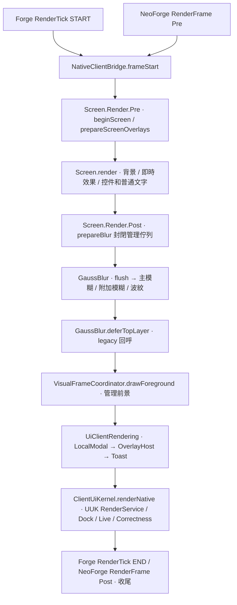

<!-- 作者：山海／dishanhai -->
# UUK 文字可讀性 · Phase 0 源碼審計

審計基線為 2026-11-12 的 `main` 工作樹，HEAD 為 `e323f05`。工作樹含既有未提交實作，以下順序和版本以該工作樹為準。審計時參照 [AGENTS.md](../AGENTS.md)、[Kernel 架構](kernel-architecture.md)、[生命週期](lifecycle.md)、[視覺對齊](VISUAL_ALIGNMENT.md)、[特效](effects.md)、[富文字排版](RICH_TEXT_LAYOUT.md)、[KubeJS](KUBEJS.md) 和 [統一頁面](kubejs-api.md)。

## 雙端基線

| 項目 | Forge | NeoForge |
| --- | --- | --- |
| Minecraft／載入器 | 1.20.1／47.4.16 | 1.21.1／21.1.251 |
| 映射 | Parchment 2023.09.03，發佈 JAR 走 `reobfJar` | ModDevGradle 2.0.148 的 Mojang 官方名稱 |
| 原生主程式 Java 目標 | Java 17 bytecode | Java 21 工具鏈 |
| 幀事件 | `TickEvent.RenderTickEvent.START/END` | `RenderFrameEvent.Pre/Post` |
| 字形頂點相容層 | `vertex().color().uv().uv2().endVertex()`，`SheetGlyphInfo.getUp/getDown` | `addVertex().setColor().setUv().setLight()`，`SheetGlyphInfo.getTop/getBottom` |
| 產物目錄 | `build/libs/`，`releaseJar` 複製重映射產物 | `neoforge/build/libs/` |

兩端共用 `src/kernel/java` 的 Java 17 公共契約和大部分 `src/main/java` 客戶端原生實作。NeoForge 依自己的建置配置替換 `UiClient`、`GaussBlur`、`VisualRevealRenderer`、`LyricGlyphPlatform` 和 KubeJS 插件等版本相依檔案。Java 21 工具鏈編譯共用契約，`kernelTest` 使用 Java 17 執行。版本、來源集和產物規則見 [Forge 建置](../build.gradle)、[Forge 版本](../gradle.properties)、[NeoForge 建置](../neoforge/build.gradle)、[NeoForge 版本](../neoforge/gradle.properties)、[共用 Kernel 建置](../gradle/kernel.gradle)。

```bash
./gradle-install/gradle-8.8/bin/gradle compileJava kernelTest --offline --no-daemon --console=plain --max-workers=2
bash neoforge/gradlew -p neoforge compileJava kernelTest --offline --no-daemon --console=plain --max-workers=2
```

基線命令兩端退出碼均為 0，`compileJava` 與 `kernelTest` 為 `UP-TO-DATE`，沿用現有輸出。日誌位於 `C:/jtmp/shbui-text-readability-YQM9LB`。

## 當前繪製順序



- `Screen.Render.Pre` 訂閱優先級為 `HIGHEST`，`Post` 為 `LOWEST`。外層幀完成時清理視覺組合和舊版模糊請求。載入畫面同步重入時，`NativeClientBridge` 以 `frameDepth` 保護外層幀，內層 `composeScreenPost` 只執行其 legacy blur 回呼。[Forge UiClient](../src/main/java/com/dishanhai/sh_better_ui/client/UiClient.java#L89) · [NeoForge UiClient](../neoforge/src/main/java/com/dishanhai/sh_better_ui/client/UiClient.java#L89) · [NativeClientBridge](../src/main/java/com/dishanhai/sh_better_ui/client/NativeClientBridge.java#L135)
- 即時 `blurNow`、`blurRoundedNow` 和區域 `VisualReveal` 會處理當時已繪的背景。紋理 `VisualRevealRenderer` 可先在 scratch target 做水平模糊，再在目前目標合成。頁面在即時效果後提交文字時，該位置的背景已完成。幀末 `GaussBlur` 先 flush 待寫入的幾何，然後以兩趟 `PostChain` 改寫主畫面，故同區域已畫文字也會受影響。舊版 `deferTopLayer` 是以 `Screen` 驗證的單一覆寫槽，回呼在 blur 的 `finally` 執行。[Forge GaussBlur](../src/main/java/com/dishanhai/sh_better_ui/client/blur/GaussBlur.java#L468) · [NeoForge GaussBlur](../neoforge/src/main/java/com/dishanhai/sh_better_ui/client/blur/GaussBlur.java#L468) · [VisualRevealRenderer](../src/main/java/com/dishanhai/sh_better_ui/client/gui/scaled/VisualRevealRenderer.java)
- `UiScreenBuilder.onForeground` 名稱中的前景指 `Screen.render` 內的 callback。它在 widget 後、標題列前執行，與普通控件同樣位於 Screen Post 模糊之前。具有幀末背景效果的頁面可在該 callback 提交清晰前景，交由對應的 Post 階段繪製。[UiScreen.renderContents](../src/main/java/com/dishanhai/sh_better_ui/client/api/UiScreen.java#L391)
- `LayoutService.bindVisual` 綁定每 Screen 一個有效 `VisualLayoutBinding`。該綁定發布一份 `FrameViewSnapshot`，包含 `AlignmentLayout` 的已呈現 transform、視口及節點 clip。背景、命中、視覺投影與 `VisualNodePass.foreground` 共用此快照。管理前景依 z 及同 z 登記順序執行，逐項檢查 frame、target 和 binding，再由 `VisualCanvas` 套用姿態和裁剪。消費後 `DrawContext` 失效。關畫面取消快照與待畫項目。應沿用這條組合路徑承載已綁定頁面的清晰前景。[VisualFrameCoordinator](../src/main/java/com/dishanhai/sh_better_ui/client/visual/VisualFrameCoordinator.java#L49) · [VisualNodePass](../src/main/java/com/dishanhai/sh_better_ui/client/visual/VisualNodePass.java#L166) · [VisualCanvas](../src/main/java/com/dishanhai/sh_better_ui/client/visual/VisualCanvas.java)
- 頁面有幀末背景效果時，取樣點應位於該層效果落盤後、該層文字之前。管理前景可在已有畫面上建立此插入點。若 `deferTopLayer` 已畫覆蓋文字或其他同位置前景，須辨識它與請求的相對順序，再選擇有效取樣點。開啟 `UiLocalModal`、`UiOverlayHost` 時，頁面前景應在其下方，彈層內文字應在各自的背景和 clip 內使用該層取樣點。它們目前各自管理背景和內容；把頁面文字延遲至全域 Post 結束會越過這些彈層。[UiClientRendering](../src/main/java/com/dishanhai/sh_better_ui/client/UiClientRendering.java#L18) · [UiLocalModal](../src/main/java/com/dishanhai/sh_better_ui/client/gui/scaled/UiLocalModal.java#L175) · [UiOverlayHost](../src/main/java/com/dishanhai/sh_better_ui/client/gui/scaled/UiOverlayHost.java#L319)
- `RenderService.submit` 可在第三方 `ScreenService.mount` 樹中提交 `CONTENT/OVERLAY/TOOLTIP`。其 `Context.text(Component,…)` 屬於晚於上述 legacy overlays 的 UUK 原生 pass。這是第三方繪製和有效上下文檢查的參考；一般頁面可讀性依自身層序使用對應的前景階段。`RenderGraph` 的 `PREPARE/CONTENT/POST` 為單目標依賴規劃，需由 native host 綁定實際階段。[RenderService](../src/main/java/com/dishanhai/sh_better_ui/kernel/api/RenderService.java) · [ClientUiKernel](../src/main/java/com/dishanhai/sh_better_ui/kernel/internal/ClientUiKernel.java#L186) · [RenderGraph](../src/kernel/java/com/dishanhai/sh_better_ui/kernel/api/render/RenderGraph.java)

## 取樣、著色與 GPU 狀態

| 路徑 | 可重用的實作與相容範圍 |
| --- | --- |
| 同幀背景複製與著色 | `ClientGlassRender.paint` 在 render thread flush 後取 `GlassSceneCapture.snapshot()`。它讀取實際 draw FBO 和 viewport，將顏色 blit 至獨立 RGBA8 texture，再讓 `GlassProgram` 同一 pass 從該 texture 著色。此路徑以 OpenGL 3.2 為能力下限，檢查可讀附件與 FBO 完整性，同尺寸 MSAA 走 `GL_NEAREST` resolve，MSAA 配合降尺寸時拒絕。它會恢復 read/draw FBO、read buffer、texture、unpack buffer 和 scissor。Glass 每 pass 單次 capture 的時間取決於第一批玻璃，文字分析需在其自己的 pre-text 階段取樣。 |
| CPU 非同步診斷 | `ClientCorrectnessPainter.draw` 已有實際 `BACKDROP_PRE_MATERIAL` 和 `POST_MATERIAL_PRE_TEXT` 取樣點。它把文字區與 clip 相交，在 glass/tint 後先 flush 再取樣，然後畫整段 glyph、描邊和陰影。`ClientBackgroundSampler` 將 ROI 降採樣至 RGBA8，用三個 PBO 和零逾時 fence 稍後讀取 CPU 診斷。結果帶來源 frame、狀態版本和內部 generation，超出預算或目標無法取樣時以狀態表達。它拒絕歧義的偏移 viewport 和無法一次 resolve 的 MSAA 降採樣。這條路徑適用於按需診斷，當幀決策需在 GPU 內完成。 |
| Glyph 著色 | 兩端共用的 `RichTextView` 經 `RichTextEffects` 將 `FormattedCharSequence` 交給 `GuiGraphics.drawString`。`RichTextEffects` 已示範保留原有 sequence 幾何並調整 style 色。原生 `LyricGlyphPlatform` 與 `VisualRevealRenderer` 示範兩端不同的頂點提交方式及 shader 註冊。普通文字以已量測整段序列作為保守著色單位，格式化 style 的顏色也須按策略處理。 |
| 跨幀 GPU 狀態 | 既有 capture/reveal 使用跨幀 texture/FBO 並重用分配。`ClientBackgroundSampler` 的 bounded slot、ticket 和 generation 可作為重用防護參考。可讀性候選與連續計時仍需跨幀儲存模型。優先驗證 OpenGL 3.2 可用的兩張狀態 texture 交替讀寫，在本幀 decision pass 讀背景及上一幀槽，寫入另一張 texture，前景 draw 使用新狀態。採用的附件格式、實際 driver 支援、GPU 用時與槽上限須隨 Phase 4 驗證。 |

[GlassSceneCapture](../src/main/java/com/dishanhai/sh_better_ui/kernel/internal/GlassSceneCapture.java) · [ClientGlassRender](../src/main/java/com/dishanhai/sh_better_ui/kernel/internal/ClientGlassRender.java) · [ClientCorrectnessPainter](../src/main/java/com/dishanhai/sh_better_ui/kernel/internal/ClientCorrectnessPainter.java#L126) · [ClientBackgroundSampler](../src/main/java/com/dishanhai/sh_better_ui/kernel/internal/ClientBackgroundSampler.java) · [RichTextEffects](../src/main/java/com/dishanhai/sh_better_ui/client/visual/RichTextEffects.java)

`VisualCanvas.target()` 確認目前 draw FBO 為 Minecraft main target，以 framebuffer 像素和連續 GUI 尺寸建立投影。沿用 `VisualProjection.Target` 的逐軸比率，先將已呈現文字 bounds 套用 transform、交集祖先與滾動視口 clip，才以左上向下的 framebuffer 像素表示取樣矩形。GL 讀取時轉換至左下座標。未知目標、無可讀附件或不支援的 transform 應標示診斷並走宣告背景或未知背景的降級。背景資料須標示附件顏色編碼，Phase 2/4 驗證只做一次 sRGB 解碼。[VisualProjection](../src/main/java/com/dishanhai/sh_better_ui/client/visual/VisualProjection.java) · [VisualCanvas](../src/main/java/com/dishanhai/sh_better_ui/client/visual/VisualCanvas.java#L23)

Forge `GaussBlur` 私有 `PostChain.passes` 先查 `passes` 再查 SRG `f_110009_`，NeoForge 版本保留相同雙名容錯。`LyricGlyphAccess` 也用官方名稱和 SRG 備選。兩條私有反射路徑有相容風險，文字服務的基本整段適配可用現有公開 draw 路徑。同幀複製應以現有 LWJGL FBO 狀態保存方式接入，避免新增對映射私有成員的依賴。[GaussBlur 映射](../src/main/java/com/dishanhai/sh_better_ui/client/blur/GaussBlur.java#L773) · [LyricGlyphAccess](../src/main/java/com/dishanhai/sh_better_ui/client/lyrics/render/LyricGlyphAccess.java)

## 排版、行重用與作用域

- `RichTextLayout` 以 Unicode grapheme 邊界換行。每個 `RichLayoutSnapshot.Fragment` 含 inline node、實際量測的字串、bounds 和邏輯 `textOffset`。`RichTextView.VanillaFont.sequence` 對需要 Bidi 的片段採語言的 visual order，再按原片段繪製。當前快照缺少視覺字形簇的字形索引、覆蓋幾何和 shaping 映射。Grapheme 邊界可保護組合符與 emoji 等文字換行，無法單獨驗證 glyph 簇切割。Phase 1 沿用完整已量測 `FormattedCharSequence`，純文字可整段提交，富文字可按已排版 style 片段提交。若請求局部分色但缺少排版引擎提供的可靠簇邊界，保留整段並以診斷標示原因。顯式邊界只在驗證與實際簇對齊後採用。[RichTextLayout](../src/kernel/java/com/dishanhai/sh_better_ui/kernel/api/richtext/RichTextLayout.java) · [RichLayoutSnapshot](../src/kernel/java/com/dishanhai/sh_better_ui/kernel/api/richtext/RichLayoutSnapshot.java) · [RichTextView](../src/main/java/com/dishanhai/sh_better_ui/client/visual/RichTextView.java)
- `NativePageList` 只畫視口中可見的字串行，目前以資料陣列索引迭代。需要跨幀狀態的消費者應由資料模型提供穩定資料項 ID。索引、可見字串或循環使用的行控件均可能對應不同資料，故不能作為持久狀態鍵。富文字可從持久 inline node ID 組合有穩定語義的片段 ID；重排後沒有穩定映射時只保留當幀結果。[NativePageList](../src/main/java/com/dishanhai/sh_better_ui/kernel/internal/NativePageList.java#L89)
- 透過 `UIApis`、`BuiltinService.candidate`、`ServiceRegistry` 與現有能力解析取得服務。使用 `KernelHost.ownedScope` 確認當前模組擁有的原生 mounted scope，再以 canonical scope 實例及其 generation 辨識作用域。原生 `SCREEN → UI_TREE → COMPONENT` 已支援逐層關閉，`ScopeLifecycle` 先 invalidate 所有後代再逆序清理。可讀性設定按欄位沿控件父子鏈解析。各彈層以自己的 render scope 為根，僅在顯式設定時繼承所屬頁面的策略。彈層生命週期、取樣點與 clip 隨原生渲染歸屬。[KernelHost](../src/kernel/java/com/dishanhai/sh_better_ui/kernel/internal/KernelHost.java#L186) · [ScopeLifecycle](../src/kernel/java/com/dishanhai/sh_better_ui/kernel/internal/ScopeLifecycle.java) · [ClientUiKernel 服務裝配](../src/main/java/com/dishanhai/sh_better_ui/kernel/internal/ClientUiKernel.java#L650)
- `SHUI` 由各載入器的 optional KubeJS plugin 綁定至 `KubeJsUiApi`，再由 `KubeJsPageBindings` 和 `ClientPages` 進入原生頁面。`UiPageType.MODAL` 在這條路徑會建立自己的頁面 `SCREEN` scope 和 `UiScreen`，可重用其獨立生命週期。附著於現有 Screen 的 `UiLocalModal` 和 `UiOverlayHost` 需要以對應的渲染層及原生作用域識別。腳本後續應透過現有頁面解析和 client-side bridge 接到同一策略，基礎服務保持可獨立於 KubeJS 運作。[KubeJsUiApi](../src/main/java/com/dishanhai/sh_better_ui/compat/kubejs/client/KubeJsUiApi.java) · [ClientPages](../src/main/java/com/dishanhai/sh_better_ui/kernel/internal/ClientPages.java#L274)

## 清理與可觀測性

- `ClientUiKernel.renderNative`、`VisualFrameCoordinator` 和原生 GL 觀測使用 render thread。畫面 close、幀結束、巢狀渲染與 resize 都可能讓暫存的繪製 context 失效。即時入口需驗證 context 所屬 frame、scope、目標和階段，離開 callback 即失效。跨幀只保存相應的穩定狀態，並限制長壽命頁面的閒置時間和容量。回收虛擬行、重新開頁、失效 scope、視窗或 render target 重建後，舊槽與舊請求應被丟棄。[NativeClientBridge](../src/main/java/com/dishanhai/sh_better_ui/client/NativeClientBridge.java#L25) · [ClientCorrectnessPainter](../src/main/java/com/dishanhai/sh_better_ui/kernel/internal/ClientCorrectnessPainter.java#L65)
- 雙端資源重載準備可在背景執行緒執行，經 barrier 後在 Minecraft 主執行緒 commit。此時可以更新資源版本並使文字、shader、capture 和依賴目標的持久狀態失效。資源失效後重新建立必要 GL 資源，scope 設定依其原有生命週期持續有效。既有 `ClientGlassRender.reload` 釋放 capture/program，`ClientCorrectnessPainter.reset` 清除對應 sampler。伺服器入口 `ShBetterUi` 支援 common 端，native 入口由 `Dist.CLIENT` 訂閱，服務與 GL 實作應只在客戶端初始化。[重載入口](../src/main/java/com/dishanhai/sh_better_ui/kernel/internal/ClientUiKernel.java#L452) · [專用伺服器 smoke 工具](../gradle/live-surface-server-smoke.init.gradle)
- 可重用 `KernelHost.report`／內核診斷做失敗觀測，並沿用 `CorrectnessInspectorScreen` 呈現來源幀、來源類型、投影和抽樣狀態的方式。可讀性診斷應按 canonical scope 和穩定 ID 查詢，對取樣結果區分 pending、stale、失效及不可用。跨幀詳細資料採現有 PBO/fence 路徑的非同步模型。`ContrastPolicy` 提供共用亮度與對比度工具，Phase 2 仍需驗證實際顏色來源、透明度和局部判定。[CorrectnessInspectorScreen](../src/main/java/com/dishanhai/sh_better_ui/kernel/internal/CorrectnessInspectorScreen.java) · [ContrastPolicy](../src/kernel/java/com/dishanhai/sh_better_ui/theme/accessibility/ContrastPolicy.java)

## 最小實驗與驗收邊界

白字純黑底和同層模糊覆蓋分開判定。純黑區先畫 `#000000`、再畫原始 `#FFFFFF`，其純色內部對比度為 21∶1，可作為原色保留對照。另一區域把相同文字提早畫入幀末模糊矩形，與相同背景效果後才畫的前景對照。比較字形內部和邊緣像素，並在有效 clip 外或更上層模態覆蓋處檢查文字沒有穿透。GL 取樣驗證可另用既有 `VisualSamplingSmoke` 確認 ROI 原點、PBO、frame/version 與 GL 狀態恢復；其 hidden-window 路徑獨立於 Minecraft 載入器。[VisualCompositionSmoke](../src/kernelSmoke/java/com/dishanhai/sh_better_ui/kernel/smoke/VisualCompositionSmoke.java) · [VisualSamplingSmoke](../src/kernelSmoke/java/com/dishanhai/sh_better_ui/kernel/internal/VisualSamplingSmoke.java)

### 本輪原生實驗

以 Git Bash 執行，Gradle 使用 JDK 21，啟動腳本讓 Forge 遊戲程序使用 Java 17，NeoForge 遊戲程序使用 Java 21。

```bash
./gradle-install/gradle-8.8/bin/gradle -I gradle/kernel-smoke.init.gradle runClient -PkernelSmokeTextReadability --offline --no-daemon --console=plain --max-workers=2 -x downloadAssets
bash neoforge/gradlew -p neoforge -I ../gradle/kernel-smoke.init.gradle runClient -PkernelSmokeTextReadability --offline --no-daemon --console=plain --max-workers=2
```

兩端均退出 0，並寫出 `success.txt` 與 `stopped.txt`。測試在 RTX 4060 Laptop GPU、NVIDIA 610.88、OpenGL 4.6、800×480 framebuffer、GUI scale 2 上執行。兩個連續幀的結果一致。

| 原生場景 | Forge 47.4.16／Java 17.0.18 | NeoForge 21.1.251／Java 21.0.11 |
| --- | ---: | ---: |
| 純黑底直接畫原色白字 | 680 個純白像素 | 680 個純白像素 |
| `Screen.render` 先畫白字，再執行同層 `GaussBlur` | 0 個純白像素 | 0 個純白像素 |
| 同層模糊完成後，從同幀背景與字形遮罩重新合成白字 | 680 個純白像素 | 680 個純白像素 |

實驗在 `GaussBlur.deferTopLayer` 內使用 `GlassSceneCapture` 複製背景至獨立的 RGBA8 紋理。原生字形渲染產生遮罩，清除主畫面的臨時字形後，GLSL 150 程式取樣背景與遮罩再合成前景。第二幀的 shader 同時檢查第一幀留下的紋理和本幀改變的標記值。像素讀回僅供煙測斷言與截圖。截圖位於 `build/kernel-verification/client-{forge,neoforge}-text-readability/text-readability.png`，兩端 SHA-256 同為 `11de3721bcae194a8d0c0a092d0c153d2ce98b2fdd10cc664fa487f2d30572ab`。 [TextReadabilitySmoke](../src/kernelSmoke/java/com/dishanhai/sh_better_ui/kernel/internal/TextReadabilitySmoke.java)

實驗覆蓋兩端開發客戶端的同幀複製、字形著色及跨幀紋理讀取。待驗證項目包括發佈 JAR 客戶端、實際整合包、其他 GPU、實際 MSAA 目標，以及可讀性路徑在縮放、資源重載、上層模態遮擋與巢狀裁剪下的運作。GPU 穩定計時、槽位預算及更多 framebuffer 類型隨 Phase 4 驗證。 [後續工作](../TODO.md)

### 專用伺服器類別邊界

兩端的 `UiClient` 都以 `Dist.CLIENT` 註冊，`ClientTextReadability` 的建立和服務註冊在 `ClientUiKernel`，兩個 common `ShBetterUi` 入口均無可讀性服務參照。開發伺服器沿用 `gradle/live-surface-server-smoke.init.gradle`，以 `build/text-readability-probe` 作為隔離 run 根目錄，Forge 遊戲使用 Java 17。 [Forge 入口](../src/main/java/com/dishanhai/sh_better_ui/ShBetterUi.java) · [NeoForge 入口](../neoforge/src/main/java/com/dishanhai/sh_better_ui/ShBetterUi.java) · [客戶端裝配](../src/main/java/com/dishanhai/sh_better_ui/kernel/internal/ClientUiKernel.java)

```bash
./gradle-install/gradle-8.8/bin/gradle -I build/text-readability-probe/server-smoke.init.gradle runServer --offline --no-daemon --console=plain --max-workers=2
bash neoforge/gradlew -p neoforge -I ../build/text-readability-probe/server-smoke.init.gradle runServer --offline --no-daemon --console=plain --max-workers=2
```

NeoForge 開發伺服器達到 `DedicatedServer: Done` 並正常關閉。類別載入日誌記錄了 `ShBetterUi`，`client.*`、`ClientUiKernel`、`ClientTextReadability` 及 `UIApis` 載入數為零。Forge 到達 EULA 前置檢查，完整啟動仍待驗證。日誌位於 `build/text-readability-probe/server-{forge,neoforge}.log` 及 `server-{forge,neoforge}/class-loading.log`。
