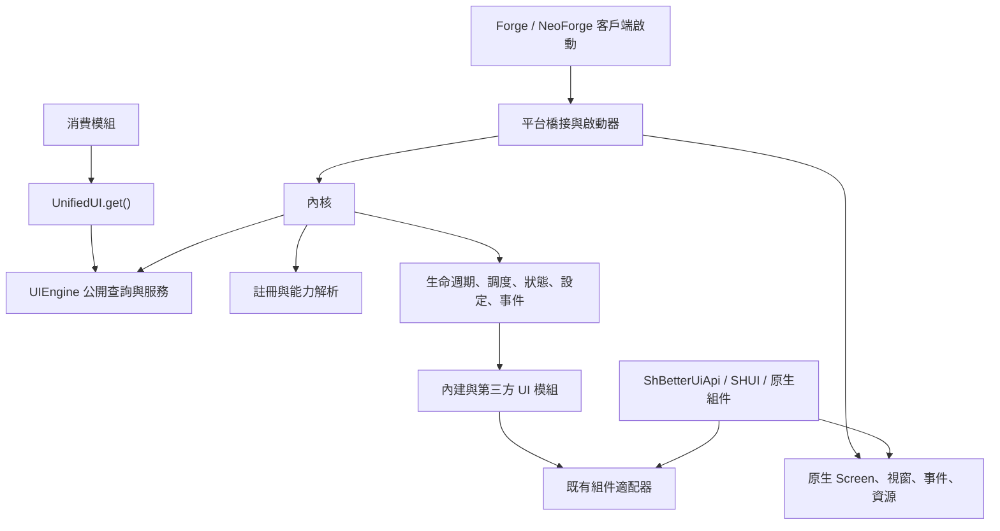

<!-- 作者：山海／dishanhai -->
# Unified UI Kernel 架構

Unified UI Kernel 將純 Java 17 內核接到九項內建 UI 服務及兩端原生客戶端。Loader 保留對啟動、原生事件與關閉的控制，第三方以同一套公開查詢和模組契約接入。 [公開 API](public-api.md) · [工程審計](kernel-audit.md) · [分階段驗證](kernel-migration-plan.md)

## 工程與入口

保留兩套獨立 Gradle 啟動點。共用 `src/kernel/java` 作為純 Java 17 source set，其中 `com.dishanhai.sh_better_ui.kernel.api` 是公開契約，`kernel.internal` 是實作。兩端透過同一份 `gradle/kernel.gradle` 把輸出接進 main、test、發行包和 sources JAR。核心使用 JDK 21 工具鏈及 `--release 17`，Forge 主程式亦保留 Java 17 位元碼，NeoForge 其餘源碼以 21 編譯。雙端獨立的 `kernelTest` 共用 `src/kernelTest/java`，以 Java 17 執行。Minecraft 適配在既有的 main 源集，雙端以各自 `UiClient` 或明列的替換類接線。 [平台相容性](platform-compatibility.md)

沿用現有 mod ID、Forge 開發／重映射 JAR 與 NeoForge JAR。核心類由 SH-Better-UI 自身封裝一次。消費模組照現行方式聲明依賴。分離 source set 可用 `jdeps` 和 class major 檢查 Java 17 的依賴邊界。正式包以 ABI 比對驗證，原生行為以隔離的開發客戶端驗證。

- `UnifiedUI.isAvailable()` 讀取已發布的引擎。未發布或撤回後，`get()` 拋出 `IllegalStateException`。啟動器在驗證及初始化後一次發布，拒絕覆寫已安裝的引擎。測試用獨立宿主驗證啟停。
- `UIEngine` 提供 `registry()`、`capabilities()`、`require(key)`、`find(key)` 和內核各領域的視圖。`require` 遇到缺失拋出含 ID、型別和契約版本的 `NoSuchElementException`，`find` 以 `Optional.empty()` 表示缺失。`platform()` 解析同一登記表中的 `UIPlatform.KEY`。
- `UnifiedUI.get()` 提供公開查詢。服務變更使用已登記的 `ModuleContext` 和 `ScopeHandle`，由宿主核對呼叫者與目標。模組可在 `context.engine().configs()` 開啟設定交易，並選擇鍵宣告允許的 `ConfigScope` 和 `ConfigLayer`。跨範圍或寫入全域需另外授權。
- `ShBetterUiApi` 與 KubeJS `SHUI` 保留靜態分組、擴充工廠和回呼簽章。新服務共用原有適配器，例如 `MotionApi`、`ThemeManager` 和原生焦點。 [遷移指南](migration-guide.md)

## 模組、服務與能力

- `UiId` 驗證 namespace 與 path，以兩個欄位保存 ID。`UiVersion` 接受三段非負整數版本，`VersionRange` 使用包含下界、排除上界的區間，上界可省略。服務鍵是 `ServiceKey<T extends UIService>(UiId, Class<T>, int contractVersion)`。同一註冊範圍以 `UiId` 檢測衝突，型別與契約版本必須完全相符。原始泛型或偽造型別走 `Class.isInstance`／`Class.cast` 驗證。
- `ServiceDescriptor<T>` 宣告鍵、提供者版本、可見範圍、優先級及可替換性。實際來源由啟動器在登記時附上。`APIRegistry` 對外為只讀。只有 `register(ModuleContext)` 期間的 `ServiceRegistrar` 能登記，關閉句柄會核對目前的登記。凍結後由內核在生命週期停止或隔離時移除服務，並發布新版快照。
- 獨占服務預設 `REJECT`。`KEEP_EXISTING` 對相容候選回傳可辨識的未取得結果。`REPLACE_IF_ALLOWED` 要求宿主授權、舊登記可替換，並保持型別、版本和可見性。模組私有服務保留原所有者。`SELECT_BY_PRIORITY` 要求雙方允許替換，再依優先級、提供者版本、模組 ID 排序。登記回呼失敗時恢復原登記，凍結後由生命週期管理移除。
- `ModuleDescriptor` 為不可變的 builder 結果。欄位包括模組 ID／版本、API 版本、必要／選用／提供能力、模組依賴及版本區間、衝突、初始化階段、執行親和性、申請權限、設定 schema 參照、資源所有權與平台限制。Loader 來源和實際授權由內核儲存。 [模組開發](module-development.md)
- `ForgePlatformBridge` 和 `NeoForgePlatformBridge` 由 Loader 的 mod 檔清單定位 `META-INF/sh_better_ui.modules`。UTF-8 檔案每行兩欄，以空白分隔 mod ID 和實作類的全名。空行與以 `#` 起首的註解行略過。mod ID 須屬於該檔，實作類須由該檔對應的具名 Java `Module` 載入，並實作 `UIModule` 及提供公開無參數建構式。實例化後驗證描述、平台、授權及依賴，再執行登記與啟動。資源包與一般 classpath 資源無法提供候選模組。
- 必要依賴形成有向圖。用階段及模組 ID 做可用節點的穩定排序，缺失、衝突和版本不合各自診斷。對未排序子圖輸出完整的循環路徑。選用邊只有在提供者相容且不成環時加入，否則記錄降級。依賴排序先於優先級。原生啟動時，被依賴圖隔離的有效候選會在生命週期快照中顯示 `BLOCKED`。
- `CapabilityKey` 指定能力 ID。`CapabilityDescriptor` 帶版本、提供者、優先級及 fallback 標記。解析器過濾相容版本後，依主要實作、優先級、版本和穩定 ID 選擇。結果列出必要及選用缺口。能力供給從已啟動的模組發布，隨其停止移除。會話、頁面及組件的可用狀態由對應服務和作用域提供。 [能力系統](capability-system.md)

## 生命週期和故障隔離

`NEW → DISCOVERING → REGISTERING → RESOLVING → INITIALIZING → READY → RUNNING → STOPPING → TERMINATED`。

1. 發現階段驗證來源、權限及描述，解析依賴順序。按此順序登記服務到私有註冊表。登記回呼不能取得尚未初始化的服務。登記結束後凍結註冊表。
2. 初始化階段按依賴啟動。模組可在自己的 context 查詢已啟動的依賴。核心錯誤進入 `FAILED`，再走停止與終止。外部模組初始化失敗時關閉其作用域，必要依賴方被阻擋。選用依賴方可讀取目前供給並走備援。失敗診斷保留來源，遊戲記錄保留例外堆疊。
3. 引擎跨世界運行。原生登入和登出依連線身分建立及釋放會話，標題畫面可獨立於會話掛載。透過 `UIApis.SCREENS` 取得 `ScreenService`，可掛載模組自身 Java `Module` 的活動 Screen，或先用 `create(context, builder)` 建立由呼叫模組持有的 `UiScreen`。同一個 Screen 在調整 GUI Scale 或尺寸時保留掛載世代，移除再開取得新世代。
4. 掛載的 UI 樹同時受 Screen 和擁有模組的生命週期約束。用 `ScreenService.session(context, id)` 建立的模組會話同時受原生連線與模組約束，適合會隨登出取消的 HUD 工作。關閉先使作用域失效，再以子先父後、模組逆依賴順序清理。排程、租約、輸入訂閱、佈局綁定、主題分支和快取隨其範圍關閉。範圍可追蹤 `AutoCloseable` 並按物件身分去重。資源清理遇到可恢復例外時保留診斷並繼續釋放。
5. `ScopeHandle` 由內核產生並附所有者、類別、世代及有效性。任何一個上層範圍或擁有模組關閉，都使該句柄失效。排程交付背景回執前檢查作用域，避免離頁後更新再次開啟的 Screen。 [生命週期](lifecycle.md)

## 調度與失效

外部 `UIScheduler` 提供可取消的提交、只讀快照與執行緒判定。提交使用已授權的範圍。推進階段、背景 executor、時鐘、佇列和配額由平台橋及內核持有。原生幀首完成至 `RENDER_PREPARATION` 的 CPU 工作，同一單調時鐘也交給既有 `UiFrameScheduler`。核心空閒時由外層原生幀推進相位。世界切換或幀外輸入回呼同步開啟的載入畫面沿用原生渲染。父頁預繪保留既有的唯讀幀語義。

活動 Screen 的 `ScreenEvent.Render.Post` 或無 Screen 的 HUD 後置事件才提供 `RENDER` 上下文。同一幀至多執行一次，依工作要求的 Screen／HUD 表面和掛載世代篩選。遮罩、隱藏的 HUD 或缺少相符表面時，工作等待下一次相符的渲染。帶期限的工作仍會逾時。幀尾進入 `CLEANUP`。渲染回呼可使用 GUI 座標、裁剪和變換，作用期間結束時還原原生狀態。

任務依範圍、相位、依賴、有效優先級和穩定提交序執行。輸入、渲染及清理使用獨立配額，其他相位共用普通回呼預算。背景回執在下一幀起於 `STATE_MUTATION` 或 `RENDER_PREPARATION` 交付。背景計算可用句柄協作取消，已開始的 UI 回呼執行至返回。逾期、替換、關閉及撤權會阻止尚未交付的回呼。 [調度與相位](scheduler.md)

髒工作依節點世代和旗標合併。同一旗標每個節點一幀最多出列一次。各服務使用各自的資料和回呼，例如 layout drain 呼叫已登記的 measure 與 arrange，動畫循環使用活動軌道，碰撞服務更新有變更的呈現幾何。 [局部失效規則](scheduler.md#局部失效)

## Screen 視覺組合

`LayoutService.bindVisual` 驗證呼叫模組及其原生 Screen 範圍，並以該範圍追蹤綁定。`AlignmentLayout` 保留原本的增量測量、約束、動畫與姿態求解。綁定在原生 Screen 繪製時以同一幀時鐘取樣一次，發布 `FrameViewSnapshot`。同一個 Screen 幀只接受一次發布。輸入、即時效果、像素投影與延遲前景讀取該快照。畫面切換、範圍關閉、重新掛載及重載會阻止舊幀的工作。

兩個 Loader 的 Screen Pre／Post 事件都委託共用 `NativeClientBridge`。Pre 開啟階段，Post 封存受管請求並交給既有 GaussBlur，依序畫舊頂層與受管清晰前景，再執行既有畫面疊層與 Kernel `RENDER`。幀尾清除取消、換頁或未到達 Post 的工作。CPU 的 `RENDER_PREPARATION` 與原生 Widget 輸入仍沿用原有調度。 [公開呼叫契約](API_REFERENCE.md#visual-layout--render-composition)

停靠視窗於 `ANIMATION` 取樣收合軌道，`GEOMETRY_UPDATE` 由 `ClientLayout` 更新同一表面的停靠快照。陰影、玻璃、裁剪和指標命中共用該次呈現的視窗邊界。PUSH 內邊距由受管兄弟節點選擇使用。HUD 視窗掛載於客戶端會話，離開世界時隨會話清理。 [停靠視窗](ADAPTIVE_DOCK.md)

## 狀態、設定與命令

- `StateKey<T>` 與 `ConfigKey<T>` 含 ID、型別與 schema。以登記的鍵實例取值。狀態依模組或目標作用域保留。派生狀態依輸入圖重算，輸入可為同一所有者的全域或同範圍值。鍵值可用不可變型別，或由 schema 提供純且可並行呼叫的防禦性複製。
- 設定由低到高為 Engine Defaults、Module Defaults、資源／主題、使用者全域、Screen、Component、Runtime Override。設定鍵宣告預設、驗證器、允許層、可變性、持久化分類、版本、描述與遷移。控制面板透過 User Global 交易寫入 `CLIENT_SETTINGS`，主題引擎與共用控件從該鍵取得已生效的設定。內建和第三方鍵共用 `UIConfigCenter.persist` 的持久化管線及落盤回執。
- `ThemeService.snapshot()` 與既有主題入口共用 `ThemeManager`。`ThemeService.scope(context, node)` 提供該 UI 樹節點的繼承式 token 分支，`configure` 只修改這個分支。節點關閉後會釋放分支。`LayoutService.styles` 可將既有 `ThemeScope` 的批量 `StyleInvalidation` 接到中央量測、佈局和繪製失效。
- 配置和狀態交易以各自的基線版本驗證型別、權限、所有權和範圍，再一次發布。過期交易或驗證錯誤保留原版本。監聽器回寫可提交下一版本，通知在當前批次完成後送出，依因果鏈與批次上限診斷 A→B→C→A。更新函式、驗證器與命令準備只能暫存意圖。
- `UICommandBus` 讓具型別的處理器以呼叫者權限準備命令。提交同時驗證狀態版本、失效旗標與後續工作容量。後續工作有獨立的 `TaskHandle`，可設逾時，須無依賴與替換鍵。副作用執行失敗可從回執查看，已發布的狀態版本繼續有效。 [設定、狀態與命令](configuration.md)

## 權限和資源仲裁

權限從 Loader 驗證的來源建立，內建模組由啟動器配置授權。第三方預設在自己的 namespace 和範圍操作。原生發現可授予已申請的 `CAPTURE_INPUT`、`BLOCK_VANILLA_INPUT` 和 `REGISTER_RENDER_PASS`，各操作仍核對目標和所有者。授權以 `ModuleContext` 和範圍句柄傳遞，下級只繼承父級允許且適用的能力。`REGISTER_SERVICE`、`REPLACE_SERVICE`、`MODIFY_GLOBAL_CONFIG`、`MODIFY_FOREIGN_SCOPE`、`ACCESS_INTERNAL_DIAGNOSTICS`、`MODIFY_GLOBAL_THEME` 分開判斷。撤銷同時封鎖後續寫入並回收對應租約，拒絕記錄包含來源、操作與範圍。權限用來約束同 JVM 的框架協作。

宿主可將已授予的權限縮至一個範圍及其後代，或撤銷授權。命令與事件的目標句柄是查詢參照，直接建立或關閉範圍須持有原始生命週期句柄。引擎狀態可公開查詢，詳細診斷依 `ACCESS_INTERNAL_DIAGNOSTICS` 授權顯示。

`OwnershipLease` 附所有者、範圍世代、優先級、期限和狀態。焦點每個原生 Screen 一槽，鼠標捕獲每個引擎一槽。動畫屬性依目標世代與屬性分槽，可由原持有人重定向，或用有界優先佇列交接。排隊及持有共用請求期限。模態層與訂閱可共存。優先級在通過權限及相容檢查後參與排序，釋放時核對租約身分。 [資源種類與合法策略](permissions.md#宣告與取得租約)

## 輸入與平台

`UIEventBus` 按型別、範圍與傳播階段索引，訂閱有穩定次序、優先級、來源、句柄和例外邊界。普通事件可同步送出或加入 `EVENT_DISPATCH`。同步分發限制遞迴深度和總分發量。輸入以固定路徑 capture → target → bubble，原版阻斷只由宿主在活動 Screen 的 `INPUT` 回呼內決定。

- `stopPropagation` 允許目前節點剩餘監聽器執行，阻止傳向其他節點。`stopImmediatePropagation` 同時停止目前節點剩餘監聽器。
- `preventDefault` 在可取消事件上設定 `defaultPrevented`，由發送方決定是否略過預設操作。`handled` 表示有處理者，仍可繼續傳播。`consume` 結束路由，對可取消的原生事件在活動且已授權範圍內才會取消原版處理。
- 指標命中採最後已提交的呈現幾何和裁剪範圍。碰撞目標按各物體的擴大命中範圍和繪製順序查索引，每次輸入只為同一碰撞佈局查一次。既有模態與捕獲路由保留優先順序，尚未處理的事件再交由活動 Screen 的內核目標判斷。原生捕獲使用共用槽位，需同時持有捕獲和原版阻斷授權。拖曳和對應的放開優先送給捕獲者。視窗失焦、換頁或拖曳回呼失敗會取消手勢並處理尚未配對的放開。
- Forge 以單軸 wheel 轉譯成 `(0, dy)`，NeoForge 保留 `(dx, dy)`。原生鍵盤回呼區分 press、repeat 和 release，字元事件保留 UTF-16 單元。指標移動以觀察事件發布。沒有有效範圍或獲准的攔截時，原生事件繼續交給原版控件。原生座標、輸入與旁白介面見 [Forge 1.20.1 Screens](https://docs.minecraftforge.net/en/1.20.1/gui/screens/) 與 [NeoForge 1.21.1 Screens](https://docs.neoforged.net/docs/1.21.1/gui/screens/)。
- `UIPlatform` 公開平台識別、UI 執行緒判定、連線會話狀態及包含 GUI Scale 與焦點的 viewport 快照。已掛載的樹可訂閱 `ScreenService.VIEWPORT_CHANGED`。平台在同步視口後核對原事件的 Screen 和世代，防止回呼換頁時把舊輸入或繪製轉交新頁面。繪製經 `RenderService.Context` 使用 GUI 座標、色值、層、裁剪、變換與 Z 值，原生 `GuiGraphics` 只在適配層的回呼期間有效。
- 原生資源重載使用單一 Loader 監聽器，將主題和 `ResourcesService.registerData` 登記的資料一起在背景準備，完成後穿過同一準備屏障回到客戶端執行緒。資料鍵須屬於登記模組的 namespace，並綁定其擁有的作用域；同作用域同 ID 不可重複，最多 1024 筆。載入器與驗證器必須是可並行呼叫的純函式，回傳不可變且符合鍵型別的非空值；不得操作 GL、畫面或內核。準備或驗證失敗使本次重載失敗，保留先前已發布的資料快照。
- 內核驗證世代和執行狀態後，在重載範圍內套用主題及既有畫面重載，再使 `AlignmentAssets` 快取失效，最後一次發布全部仍有效資料與資源版本，並通知仍存活的訂閱者。原生套用回呼自身的外部副作用不具回滾保證。過期準備結果捨棄；準備開始後才登記的資料等待下一次重載。`Data.snapshot()` 在第一次成功重載前或關閉後回傳空值，成功後帶資料提交世代；關閉句柄或所屬作用域會撤回該資料。視覺揭示暫存目標、波紋離屏目標／字形圖集、文字遮罩、電弧 Logo、歌詞字形圖集、音樂封面及高斯模糊後處理鏈已接到中央 GPU 租約，既有失效入口透過租約釋放，內核停止時也會清理。原生模態堆疊使用 Screen 作用域的 `MODAL_LAYER` 租約，保留既有焦點和關閉動畫，Screen 關閉或內核停止時強制清理。這些接線已通過雙端 Java 21 編譯，實機模態行為及 GPU 回收尚待驗證。

GraalVM 21 的非遊戲獨立宿主已直接呼叫 NeoForge 成品內的共用 `ClientResources`：確認 prepare 不發布，首次 commit 發布並通知一次；驗證器拒絕時保留舊值與通知數；新準備批次使舊批次過期且不執行其 installer；新批次發布最新值；關閉資料後快照為空。日誌為 `build/reports/resource-data-boundaries-java21.log`。使用直接 executor 與不讀取 ResourceManager 的純資料載入器，沒有建立 Minecraft 客戶端、圖形上下文或執行 GL；因此不涵蓋背景並行、真實資源包、主題回呼、原生 F3+T 和 GPU 釋放驗收。

## 內建服務與效能

`UIApis` 已登記 `THEME`、`ANIMATION`、`LAYOUT`、`INPUT`、`FOCUS`、`COLLISION`、`RENDER`、`RESOURCES`、`ACCESSIBILITY`。各服務共用既有組件和模型。模組可查詢 Minecraft 旁白能力，系統螢幕閱讀器能力回報 `UNAVAILABLE`。分項回歸見 [遷移計畫](kernel-migration-plan.md)。

幀內使用已解析的服務引用、快照世代與活動節點集。`SchedulerSnapshot` 提供佇列、執行結果及相位計數和耗時。可重放的基準、量測範圍、平台 CPU／GPU 邊界與實測調整見 [效能](performance.md)。第三方消費端可從 [範例模組](../examples/kernel-extension/README.md) 或 [遷移指南](migration-guide.md) 開始。
