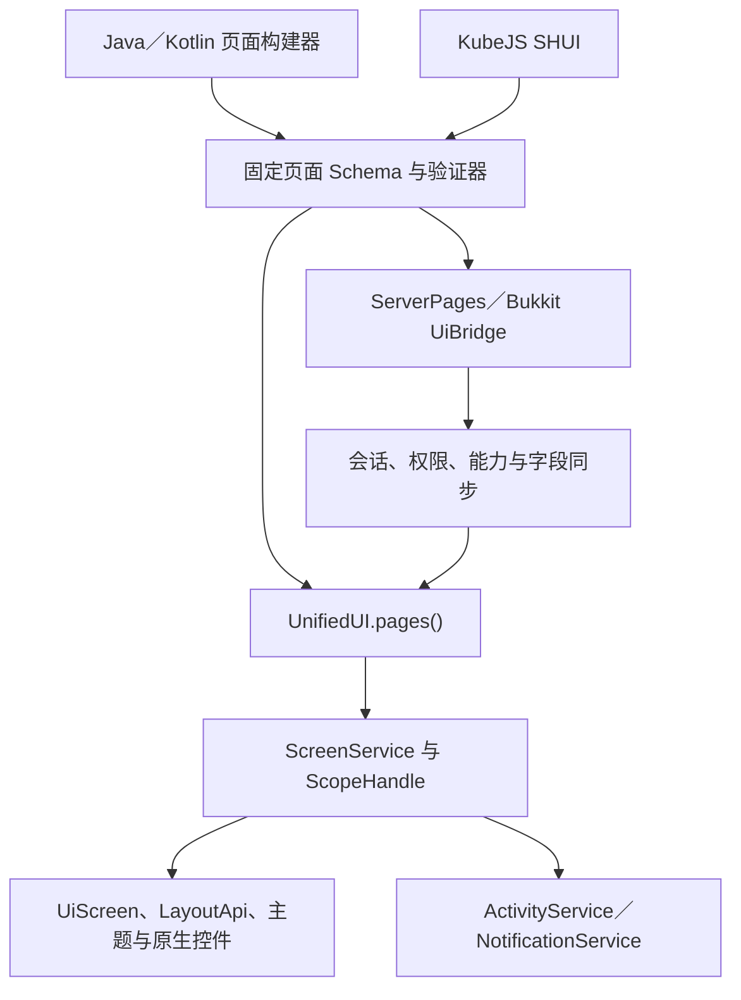

<!-- 作者：山海／dishanhai -->
# Unified UI Kernel 第三方接入

面向 Forge 1.20.1、NeoForge 1.21.1 的 Java／Kotlin 模组，两个版本的 KubeJS 客户端脚本，以及通过 Bridge 接入的 Bukkit 业务插件。声明式页面与协议是 **Experimental** API，Schema 和协议当前分别为 `1.0.0`。

## 仓库审计



| 层 | 仓库已有能力与接入点 |
|---|---|
| 服务与模块 | `UnifiedUI.get()`、`UIEngine`、`ModuleContext`、`CapabilityKey` 和 `RegistrationHandle`。新增 `PageService.KEY` 通过内核服务注册表发布。 |
| 生命周期与调度 | `ScreenService`、`ScopeHandle` 和平台线程桥已管理 Screen、连接、清理与宿主调度。页面实例随所属作用域释放。 |
| 视觉与输入 | 原生 `UiScreen`、`LayoutApi`、Minecraft 布局元素、焦点和旁白适配接入已有主题与视觉对齐。材质、动画和输入服务继续通过现有 Kernel API 使用。 |
| HUD 与通知 | `ActivityService`、`NotificationService` 和现有客户端偏好承载被动页面投影。 |
| 网络 | 仓库已有独立的 Live Activity 协议。声明式页面采用自己的版本与可选 PLAY 通道 `sh_better_ui:pages`。Forge 使用原始自定义载荷事件，NeoForge 使用可选双向 PLAY payload 注册。Bridge 通过 Bukkit 插件消息通道传递同样的帧。 |
| 源集 | `src/kernel/java` 继续使用纯 Java 17。Forge 的游戏源集使用 Java 17，NeoForge 使用 Java 21。两端共用 Schema、验证、协议与测试，通过各自 Loader 桥接。 |

本次从共享模型与离线验证开始，随后接入页面生命周期、数据和操作会话，再接入客户端载荷、KubeJS 和 Bukkit。通道能力、第一帧呈现与真实服务端联机是独立的验收项。原生客户端依赖与 Bukkit 插件依赖分别由各自宿主提供。 [Kernel 架构](kernel-architecture.md) · [视觉对齐](VISUAL_ALIGNMENT.md)

## 接入入口

| 接入方 | 使用方式 |
|---|---|
| Forge／NeoForge 客户端模组 | 依赖目标 Loader 的 SH-Better-UI JAR。Kernel 模组在客户端线程用 `UnifiedUI.pages()` 注册并打开自己命名空间内的页面。 |
| Forge／NeoForge 服务端模组 | 在服务端线程用 `ServerPages.register/open/update/close`，注册时绑定开页权限和每个服务端动作的处理器。 |
| Kotlin | Kotlin DSL 委托同一 Java builder，产出同一份页面模型与编码。 |
| KubeJS | 在 `kubejs/client_scripts/` 用 `SHUI.registerPage/open/on` 注册及处理当前脚本世代的本地页面。 |
| Paper／Spigot | 业务插件声明 Bridge SDK 的编译依赖与 Bridge 插件的运行时依赖，从 `UiBridgeProvider` 取得服务。 |

同 JVM 的模组与业务插件各自引用公开 SDK。客户端声明只携带有限类型的控件、属性、数据和操作 ID。业务动作由服务端检查当前权限、参数及真实状态，再提交事务和权威数据更新。 [页面 Schema](page-schema.md) · [协议](protocol.md) · [KubeJS](kubejs-api.md) · [Bridge](paper-spigot-bridge.md)

## 打开本地页面

持有由 Kernel 交付的 `ModuleContext`，在客户端线程调用。页面、动作和稳定控件 ID 的构建方式见 [页面 Schema](page-schema.md)。

```java
PageService pages = UnifiedUI.pages();
RegistrationHandle registration = pages.register(context, page);

PageService.Instance instance = pages.open(context, page.id(), initialData, actionId -> {
    // 处理当前客户端的 LOCAL 动作。
});
instance.displayed().thenAccept(shown -> {
    // 首帧呈现后获得 true。呈现前终止时获得 false。
});
instance.closed().thenAccept(snapshot -> {
    // 读取最终快照。
});
```

使用 `instance.snapshot().instanceId()` 定位本地更新。关闭实例或撤销注册会释放相关作用域。Java 与 Kotlin 的离线示例可以独立构建并导出静态定义。 [Java 与 Kotlin 页面 SDK 示例](../examples/page-sdk/README.md)

`PageService.components()` 和 `pageTypes()` 提供当前客户端渲染能力。Forge／NeoForge 的游戏内兑换示例另含被动 HUD 和通知。 [第三方模组示例](../examples/kernel-extension/README.md)

## 打开远程页面

服务端注册后通过 `ServerPages.open` 或 `UiBridge.openPage` 请求开页。进度回执区分 `RECEIVED`、`AUTHORIZED` 和 `CONFIRMED`。终态为 `DISPLAYED`、`REJECTED`、`TIMED_OUT` 或 `CLOSED`。根据终态为原版客户端或权限拒绝提供适合业务的原生入口。 [Bukkit 兑换示例](../examples/paper-spigot/README.md)

客户端连接默认需要玩家授予相应表面的权限。关闭当前界面后执行 `/shbetterpages screen`、`/shbetterpages modal`、`/shbetterpages hud` 或 `/shbetterpages notification`，查看并授予或撤销当前连接的权限。撤销会处理同类型的排队请求和已挂载页面。换服或断线后按新连接处理。

真实方块或实体交互用 `ServerPages.openForInteraction` 匹配短期且一次性的目标令牌。`CONFIRMED` 动作通过服务端处理器提供对象、数量及后果，收到玩家确认后再次检查权限和权威状态。优先模态另需玩家允许，可暂停符合条件的远程页面，关闭后重新核对权限并同步状态。 [协议](protocol.md) · [安全与权限](security.md)

## 当前可用范围

- `SCREEN` 与 `MODAL` 复用原生页面布局、控件、滚动及焦点。第三方可通过 `PageService.registerComponent` 注册组件描述和受限渲染工厂。远程协商只公布明确允许远程使用且当前可用的能力。 [页面 Schema](page-schema.md)
- `HUD` 与 `NOTIFICATION` 分别使用 `hud_panel` 和 `notification` 根节点。页面标题必填，可加入一个 `text` 详情和一个 `progress_bar` 进度。生命周期、配额及表现沿用现有活动与通知系统。
- `CONTAINER` 在 Forge／NeoForge 通过 `ServerPageContainers` 绑定原生槽位。Paper／Spigot 可用 Bukkit Inventory 回退。 [容器接入](container-integration.md)

## 页面 Studio

在主控面板打开开发者面板，选择顶部的 **页面 Studio**。它沿用 Kernel Inspector 的页签、滚动、键盘选择和返回入口。

- **页面树**显示稳定 ID、控件类型、属性类型、绑定字段、动作策略、修订号和实际应用的降级。
- **页面布局**显示测得的控件边界、滚动偏移、可用状态、当前焦点和开启 Trace 后采集的渲染耗时。
- **协议**显示连接身份、会话、版本、能力、权限和队列。开启 Trace 后显示消息大小、错误码及动作往返耗时。

使用 JVM 参数 `-Dshb.pages.trace=true` 保存最近关闭的一个前景页面的检查记录，断线时清理。检查记录省略属性值、绑定值和操作参数。界面默认可查看已注册的静态页面和当前挂载的实时页面。可用 `/shbetterpages trace` 查看最近八条协议元数据。
